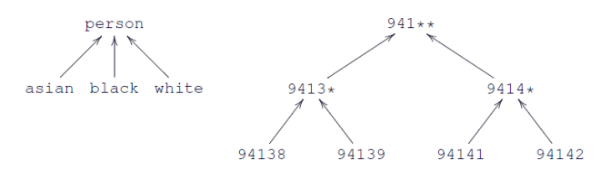
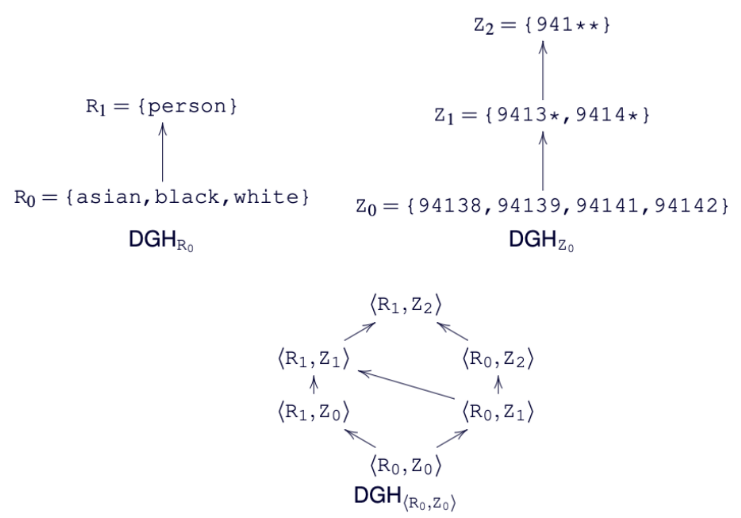
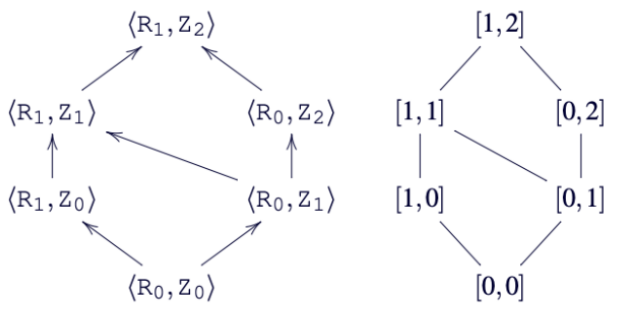
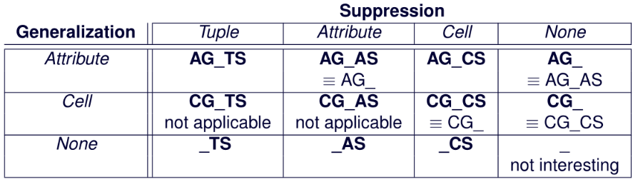
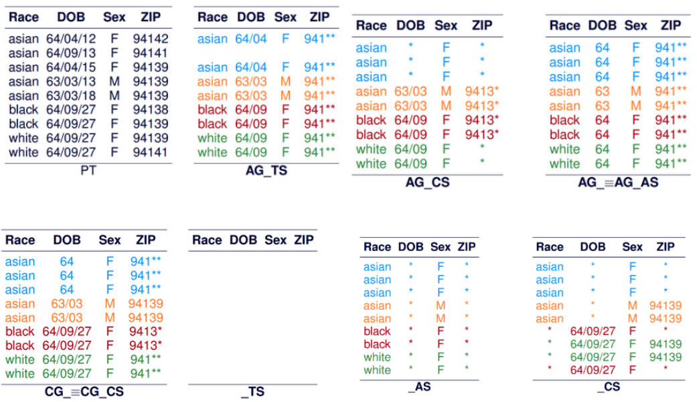
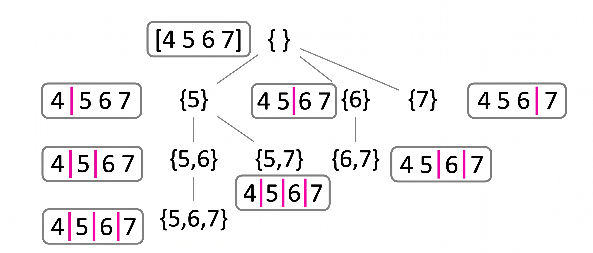
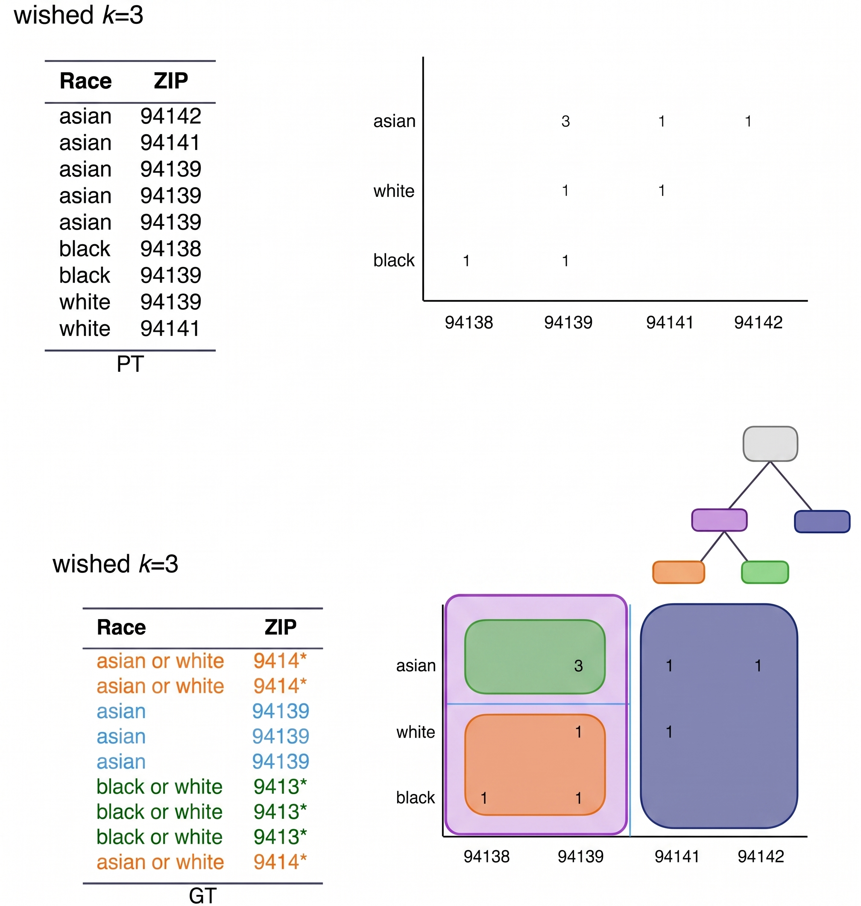

# K-anonymity

La k-anonymity mira garantire un livello minimo di protezione garrantendo che ogni record appartenga ad una 'classe' di almeno $k$ individui.
##### DEF. - K-anonymity
Un dataset soddisfa k-anonymity sse ogni combinazione dei valori di quasi-identifier compare almeno $k$ volte nella tabella. 
$k \in N$ è la **minima soglia di cardinalità** per ogni classe.

K-anonymity lavora attraverso:
- **Generalizzazione**: sostituzione dei valori con versioni più generiche ie. DOB dd/mm/yy $\to$ **/mm/yy
- **Soppressione**: eliminazione di tuple o celle

### Generalizzazione
Possiamo definire una gerarchia di generalizzazione come un ordinamento per valori da più specifici a più generici.
La generalizzazione gode di proprietà di **monotonicità** in quanto produce sempre insiemi meno specifici: se $T*$ soddisfa $k$-anonymity allora ogni sua ulteriore generalizzazione la soddisfa.

#### DEF. - Generalizzazione di Tabelle
Date due tabelle $T$ e $T'$:

$T' \preceq T$ ($T'$ è versione generalizzata di $T$) se:
- $|T'| \le |T|$
- $\forall t \in T$ esiste un corrispondente valore generalizzato $t' \in T'$ (esiste una funzione $f_T$)

#### DEF. - Gerarchia di Generalizzazione
Per ogni attributo quasi-identifier esiste un ordinamento per i **generalization domain** $GD$:

Dato $T_0$ dominio originale la **gerarchia** è un ordinamento di domini:

$$T_0, T_1, ..., T_n \text{ t.c. } T_0 \le_D T_1 \le_D ... \le_D T_n$$

L'operatore $\le_D$ mappa un dominio ad una sua versione generalizzata ($T_0$ è la versione originale).

**NB:** I valori massimali sono spesso singleton, di conseguenza al massimo livello di generalizzazione tutti i valori collassano in un unico valore generico (equivalente a soppressione) ie. "*", "N/A".

Possiamo quindi organizzare i valori generalizzati in alberi che hanno come foglie i valori più specifici e alla radice il più generico.

  

I campi di una tabella non costituiscono un singolo dominio ma un insieme di essi, di conseguenza data una tupla di attributi $A_1, ..., A_n$ la gerarchia di generalizzazione complessiva è definita come il prodotto cartesiamo delle gerarchie dei singoli domini:
$$ GD_{tot} = GD_{A_1} \times GD_{A_2} \times ... \times GD_{A_n}$$

#### DEF. - Reticolo di Generalizzazione (Lattice)
Un reticolo di generalizzazione rappresenta lo spazio di ricerca di tutte le versioni generalizzate di una tabella. La **cardinalità del reticolo** è data dal prodotto del numero di livelli di generalizzazione per ogni attributo:

**ES**
Dati: 
- $R$ attributo con |$GD_{R}| = 2$
- $Z$ attributo con |$GD_{Z}| = 3$
$$ |Lattice| = |GD_{R}| \cdot |GD_{Z}| = 2 \cdot 3 = 6$$

Il lattice ha come bottom il dato originale $\lang R_0 , Z_0\rang$ e come nodo "pozzo" finale il massimo livello di generalizzazione $\lang R_1 , Z_2\rang$:

  

#### DEF -  Generalizzazione con Soppressione

Date due tabelle $T$ e $T^{*}$:

$T \preceq T^{*}$ ($T^{*}$ è una versione generalizzata con soppressione di $T$) se:
- $|T^{*}| \le |T|$: la soppressione opera in maniera sottrativa 
- $Dom(A, T^{*}) \ge_D Dom(A, T)$: per ogi attributo i dati non possono diventare più specifici
- $\exists f: T^{*} \to T$ ed $f$ è iniettiva: ogni tupla in $T^{*}$ deve avere un corrispondente in $T$, tutte quelle che non hanno un corrispondente sono state quindi soppresse.

#### DEF - Distance Vector

Per una tabella dato un insieme di $n$ quasi-identifier $QI_1, QI_2, ..., QI_n$ definiamo il vettore delle distanze:
$$ V = [d_1, d_2, ..., d_n ] \text{ con } d_i \in \N$$

Dove $d_i$ indica il **livello di generalizzazione** dell'attributo $QI_i$

Abbiamo quindi stabilito un sistema di coordinate all'interno del **lattice**:

  

## K-minimal Generalization con Soppressione

#### DEF. - Problema di Soppressione Minimale
Date le tabelle $T \preceq T^{*}$, sia **MaxSup** la massima soglia di tolleranza per la soppressione (massimo numero di righe sopprimibili).

#### DEF. K-Minimal Generalization
Una tabella $T^{*}$ è una **k-minimal generalization** (soluzione ammisibile) di $T$ se rispetta $k$-anonymity ed ha tre proprietà:
##### 1. Minimalità della soppressione
Per un certo vettore delle distanze $T^{*}$ deve preservare il maggior numero di tuple possibile. Se esiste un'altra tabella $T^{**}$ che soddisfa k-anonymity allora:
$$|T^{*}| \ge |T^{**}|$$

#### 2. Rispetto di MaxSup
$$|T|-|T^{*}| \le \text{MaxSup}$$

#### 3. Pareto Optimality
Non esiste $T^{**}$ che soddisfi $k$-anonymity il cui vettore delle distanze **domini** quello di $T^{*}$

**NB:** Un vettore $V'$ domina $V$ se:
- Ha valori minori o uguali in tutte le componenti
- Ha almeno un valore strettamente minore tra tutte le componenti

#### DEF. - Soluzione minimale
Dato $S$ insieme di tutte le generalizzazioni $T*$ di $T$ che soddisfano:
- k-anonymity
- $$|T|-|T^{*}| \le \text{MaxSup}$$

Allora $T^*$ è soluzione minimale se $\not\exists T**$ t.c.:
$$DV_{T, T**} < DV_{T, T*}$$

Sostanzialmente non devono esistere soluzioni ammissibili più precise di $T*$

**NB**: lavorando con vettori multidimensionali difficilmente esiste un unica soluzione minimale, va spesso fatta una valutazione caso per caso su quale sia migliore per la situazione specifica.

### Criteri di Scelta per Soluzioni

#### Criterio di Dominanza
Scegliere la soluzione $T^*$ il cui distance vector **domini** gli altri (si trova al **livello inferiore nel reticolo**), in caso di parità scegliamo $T*$ con cardinalità massima (ha soppresso meno tuple).

#### Criterio delle Metriche
Per distance vector incomparabili (profondità su rami diversi ie. $[1,0]$ vs $[0,1]$) introduciamo metriche ausiliarie per la scelta
##### Minimum Absolute Distance
Calcoliamo la somma dei passi di generalizzazione:
$$\text{Dist}_{ABS}(V) = \sum_{i=1}^n d_i$$
e scegliamo il valore minimo.

**Limite**: Gli attributi vengono trattati allo stesso modo anche se le gerarchie di generalizzazione hanno profondità diverse.

##### Minimum Normalized Distance
Calcoliamo la somma pesata rispetto all'altezza dei passi di generalizzazione, con $|H_i|$ altezza massima nel lattice di generalizzazione per l'attributo $d_i$:
$$\text{Dist}_{NORM}(V) = \sum_{i=1}^n {d_i \over |H_i|}$$
e scegliamo il valore minimo.

##### Discernibility
Analizziamo come sono raggruppati i dati e scegliamo soluzioni che **discriminano maggiormente** le entità, preferendo più gruppi (classi di equivalenza) composti da un numero più contenuto di elementi.

##### Minimal Suppression
Scegliamo la soluzione che ha soppresso meno righe ($\text{max}(|T_i|)$).

## Tecniche per K-anonymity

#### Generalizzazione
- **Globale (Full-Domain Generalization) - $\texttt{AG}$**: applichiamo generalizzazione a livello di colonna
- **Locale (Cell Generalization)- $\texttt{CG}$**: applichiamo generalizzazione al livello di cella ove necessario per soddisfare k-anomimity, crea una tabella con dati non omogenei

#### Soppressione
- **Tupla (Record Suppression) - $\texttt{TS}$**: Sopprimiamo l'intera riga. Tecnica comune per gestire outlier.
- **Attributo (Column Suppression)- $\texttt{AS}**: Sopprimiamo l'intera colonna. Utile per attributi molto sensibili o per attributi che non hanno rilevanza nelle analisi post-anonimizzazione.
- **Cella (Cell Suppression)- $\texttt{CS}$**: Elidiamo il singolo valore specifico (rimpiazzato con un valore generico $\texttt{*}$). Approccio più conservativo che non altera la struttura della tabella.

  

##### ES

  

# Algoritmi per $k$-anonimity

## Generalizzazione Locale vs Globale
É fondamentale puntualizzare una differenza chiave tra come $\texttt{AG}$ e $\texttt{CG}$ ci consentono di soddisfare $k$-anonimity: operare a livello di cella ci consente di preservare maggior informazione, soprattuto in casi in cui esistono già tuple con campi identici (intervenendo su altri campi).

Possiamo quinfi stabilire delle condizioni più rilassate basate sulla mappatura tra una tabella privata $PT$ e una tabella generalizzata $GT$. Dati:
- $PT[QI]$: proiezione dei $QI$ per la tabella privata
- $GT[QI]$: proiezione dei $QI$ per la tabella generalizzata

Devono valere le seguenti proprietà

1. **Correttezza (Covering)**

    $\forall v_{pt} \in PT[QI] \exists v_{gt} \in GT[QI]$ t.c. $v_{pt} \preceq v_{gt}$  ($v_{gt}$ sia generalizzazione di $v_{pt}$)

2. **Sicurezza ($k$-cardinality)**

    $\forall v_{gt} \in GT[QI] |\{v_{pt} \in PT[QI] \text{ t.c. } v_{pt} \preceq v_{gt} \}| \ge k$ (l'insieme delle $v_{pt} \in PT$ generalizzate in $v_{gt}$ ha cardinalità almeno $k$)

Sostanzialmente abbiamo cambiato il paradigma da "un rilascio deve contenere almeno $k$ tuple con $QI$ uguali" a "un rilascio deve contenere tuple riconducibili ad almeno $k$ elementi delle tabella originale".

## Algoritmi per AG_TS

### Algoritmo Samarati
[VEDI APPUNTI ANDREA PER ESEMPIO]

### Algoritmo K-Optimize
K-Optimize lavora **raggruppando valori adiacenti in un dominio totalmente ordinato**. Ciò richiede che gli attributi appartengano a domini ordinabili, in caso contrario va stabilito un ordinamento artificiale.

La soluzione viene rappresentata come un insieme di **tagli** che dividono il dominio in intervalli: ogni intervallo rappresenta un insieme di valori del dominio che collassa in un unico valore generalizzato (ie. un range/insieme).

L'algoritmo esplora lo spazio delle soluzioni con un **Set Enumeration Tree**:
- **Root**: insieme senza tagli, il caso più generico (tutti i valori in un unico bucket)
- **Branches**: Per ogni figlio viene aggiunto un taglio (dividiamo in sottogruppi più specifici)

La soluzione ottima viene trovata attraverso **pruning** (tramite visita DFS e tecnica *branch-and-bound*):
- Se un nodo **non soddisfa k-anonymity** (oppure ha già un costo peggiore della miglior soluzione trovata finora) possiamo potare il sottoalbero, poiché aggiungere tagli rende le partizioni ancora più piccole e specifiche. **NB**: La tecnica di pruning va riformulata per casi che ammettono soppressione.
- Tutti i nodi visitati (interni o foglie) che soddisfano k-anonymity sono soluzioni valide, tra cui l'algoritmo restituisce quella a costo minimo.

  

### Algoritmo Incognito
Incognito prende in considerazione la **monotonicità di sottoinsiemi di quasi-identifier**: perché una tabella soddisfi k-anonymity rispetto a un insieme di $n$ attributi QI, è necessario (ma non sufficiente) che soddisfi k-anonymity rispetto a qualsiasi sottoinsieme di tali attributi.

#### Iterazione
1. **Controllo sui singoli attributi ($C_1$)**
    
    Per ogni singolo attributo $QI_i$ esploro la gerarchia di generalizzazione e scarto i nodi che non soddisfano la $k$-anonymity e tutti i loro discendenti più specifici.

2. **Controllo sulle coppie di attributi ($C_2$)**

    Costruisco i reticoli combinando le coppie di attributi $(QI_i, QI_j)$ sopravvissuti a $C_1$, scartando i nodi del reticolo che non soddisfano la $k$-anonymity.

3. **Controllo sulle $i$-uple di attributi ($C_i$)**

    Al passo $i$-esimo genero i reticoli candidati combinando $i$ attributi a partire dai nodi validi al passo $i-1$, e scarto quelli che non garantiscono la $k$-anonymity.

    **NB**: Questo passo (ispirato all'algoritmo *Apriori*) si basa sul fatto che se una generalizzazione su un sottoinsieme di $i-1$ attributi non garantisce la $k$-anonymity, allora nessuna generalizzazione sul sovrainsieme di $i$ attributi con gli stessi livelli potrà garantirla.

Una volta costruito lo spazio delle generalizzazioni papabili posso esplorarlo in maniera bottom up per cercare le soluzioni ammissibili. 

    [ESEMPIO ANDREA]

## Algoritmi per _CS e _CG
Operando a livello della singola istanza lo spazio di ricerca cresce enormemente (tutte le possibili combinazioni di valori), a beneficio di dati più utili (meno omogeneizzati).

## Algoritmo di Modrian
Affronta k-anonymity trattando le **tuple come punti in uno spazio geometrico multidimensionale**, in cui il dominio di ogni $QI$ rappresenta una dimensione. 

Anche in questo caso è **necessario stabilire un ordinamento per i domini non numerici** e risulta particolarmente importante che questo sia **adatto alle finalità del dataset** per preservare il significato semantico del dato (ie. un ordinamento alfabetico per le città non preserva la vicinanza geografica post generalizzazione).

Tuple duplicate (rappresentate con lo stesso punto) contribuiscono al **peso** del punto che le rappresenta.

### Greedy Partititioning
L'algoritmo segue un esecuzione **ricorsiva top-down**:

1. **Inizializzazione**
    
    Si considera l'intero spazio come un'unica regione (iper-rettangolo)

2. **Scelta e taglio**
    
    Si seleziona una dimensione (attributo) e si divide lo spazio in due sottospazi $L$ e $R$. L'euristica più comune è scegliere la mediana dell'attributo col range (normalizzato) di valori più ampio.

3. **Condizione di Arresto**
    
    Un taglio è considerato valido solamente se i $L$ ed $R$ contengono **almeno $k$ tuple**, si procede finchè non rimangono ulteriori tagli validi.

Terminato il partizionamento tutte le tuple appartenenti allo stesso sottospazio vengono generalizzate per essere indistinguibili.

##### ES

  

Questo approccio consente una maggior flessibilità rispetto al numero di attributi e consente un applicazione mista di generalizzazione/soppressione

Esiste una versione rilassata dell'algoritmo che consente di distribuire tuple con lo stesso valore sull'attributo del taglio su più gruppi.

