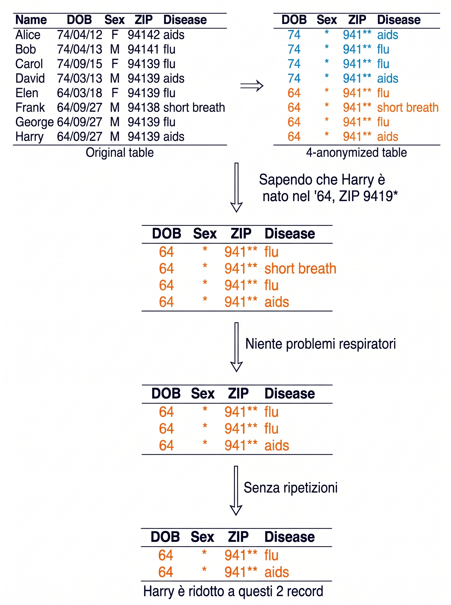
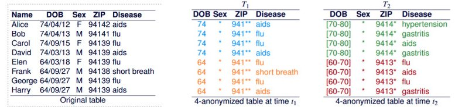

# Attribute Disclosure
Sebbene $k$-anonimity protegga l'individuo da attacchi finalizzati alla reidentificazione non è sufficiente per proteggere il **valore** del dato sensibile. 
L'attribute disclosure riguarda casi in cui un attaccante, pur non conoscendo esattamente quale riga corrisponda ad un soggetto preciso, riesce a inferire con certezza (o alta probabilità) il valore di un attributo sensibile (es. la malattia).

Vi sono due vettori d'attacco principali:
- **Homogeneity Attack**: se tutte le tuple in una classe di equivalenza hanno lo **stesso valore sensibile**, identificata l'**appartenenza** di un individuo ad una classe rivela il valore sensibile, anche se non si ricoustruisce la riga corrispondente all'individuo
- **Background Knowledge Attack**: l'attaccante usa conoscenze esterne che consentono di escludere righe della classe di equivalenza, deducendo il dato per esclusione (o comunque riducendo ad un set più contenuto)

In luce di ciò introduciamo alcuni modelli che ampliano $k$-anonimity.

#### DEF - $l$-diversity

Un blocco (classe di equivalenza) si dice $l$-diverse se contiene **almeno $l$ valori distinti per l'attributo sensibile**. Una tabella soddisfa $l$-diversity se ogni suo blocco è $l$-diverse.

In questo modo l’attaccante deve eliminare almeno l − 1 valori prima di poter inferire qualcosa con certezza

##### Limiti di $l$-diversity
$l$-diversity rimane vulnerabile a due attacchi più sofisticati
- **Skeweness Attack**: se la distribuzione interna di un gruppo è molto diversa da quella reale un attaccante, conoscendo il gruppo di appartenenza, può inferire con buona probabilità il dtao sensibile.

    **ES**:Se in un gruppo il 75% dei pazienti ha l’HIV e nel mondo reale la media è l’1%, sapere che Mario è in quel gruppo permette di inferire con un’altissima probabilità (75%) che sia malato.

- **Similarity Attack**: Se i valori sono sintatticamente diversi ma semanticamente simili può comunque esserci un leak di informazione
    
    **ES**: "Gastrite", "Ulcera", "Reflusso" sono stringhe diverse, ma semanticamente indicano tutte "Problemi allo stomaco".

#### DEF - $t$-closeness
Un gruppo soddisfa $t$-closeness se la distanza tra la **distribuzione dei valori sensibili** nel gruppo e la distribuzione nel dataset (o reale) è inferiore ad una soglia $t$.

In pratica, il gruppo deve essere un campione rappresentativo della popolazione.

## Fattori esterni al dataset
### External Knowledge Modeling
U punto critico di tutti i modelli elencati è la conoscenza a priori dell'attaccante, possiamo modellare il suo **vantaggio informativo** in due classi:
- **Instance-level knowledge**: l'attaccante ha informazioni su individui specifici (ie. associazione nome/malattia)
- **Same-value families**: l'attaccante conosce elementi di correlazione tra gli utenti (ie. in questo DB elementi della stessa famiglia condividono le stesse patologie ereditarie)

###### ES
Sapendo che Harry è nato nel '64, ha ZIP 9419 e non ha problemi respiratori posso ridurrlo a due record:

  

### Pubblicazioni multiple e dati dinamici
Il problema dell'anonimizzazione si complica molto in contesti di rilascio periodico (ie. banche dati mediche), in quanto ogni rilascio non va più trattato come un problema di anonimizzazione a sè stante ma va inserito in un contesto più ampio, si apre la possibilità ad un altro tipo di attacco.

#### Attacco di intersezione
Se un individuo è presente in più rilasci consecutivi un'attaccante può intersecare le tabelle per deanonimizzare una riga
###### ES
Alice è presente sia nel rilascio $T1$ che in $T2$. Se in T1 le possibili malattie sono $\{Aids, Influenza\}$ e in T2  $\{Aids, Cancro\}$, l’intersezione rivela che Alice ha certamente l’$Aids$.

  

    
### $m$-invariance
Per proteggere riliasci sequenziali definiamo la proprietà di $m$-invariance.
##### DEF - $m$-invariance
Una sequenza di rilasci rispetta $m$-invariance se:
- Ogni grupppo contiene almeno $m$ tuple
- L'insieme di valori sensibili associati ad una tupla deve rimanere costante nel tempo. Se un individuo cambia gruppo, il nuovo gruppo deve avere la stessa composizione di valori sensibili del precedente.
- Nessun valore sensibile appare più di una volta nello stesso gruppo (massima diversità).

## Paradigmi per le Tecniche per la Privacy
Possiamo classificare le tecniche di protezione dei dati in due grandi paradigmi, basati su come definiscono e misurano la sicurezza.

#### Privacy Sintattica
Approccio che si focalizza sulla **forma del dataset rilasciato**. Utilizza tecniche  che modificano i dati affinché soddisfino una certa regola strutturale (come $k$-anonymity, $l$-diversity, ...).

Sebbene utile, questo approccio è fragile. "Sembrare" anonimi non garantisce di esserlo davvero, soprattutto contro attaccanti che possiedono molta background knowledge.

#### Pivacy Semantica

Approccio che si focalizza sulle **proprietà del meccanismo che genera i dati**. L’obiettivo è proteggere gli individui a prescindere dalle conoscenze esterne dell’attaccante.

Per garantire ciò, si utilizzano tecniche perturbative che introducono rumore (anziché generalizzare), cercando il miglior bilanciamento matematico tra privacy e utilità.
