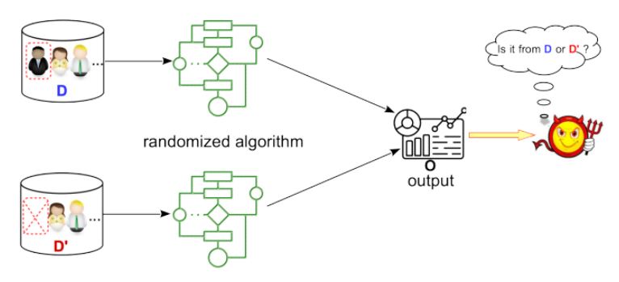
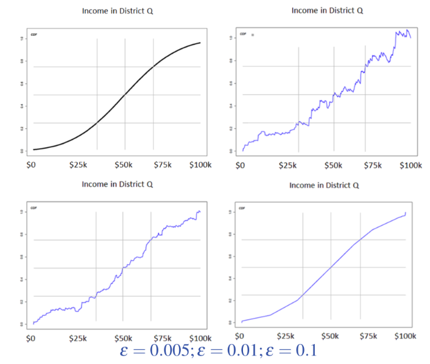
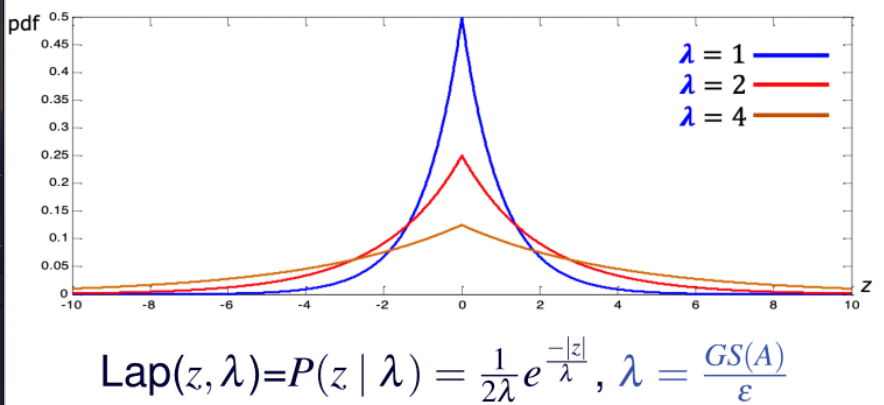
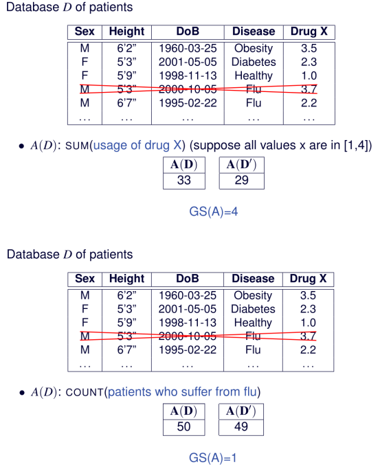
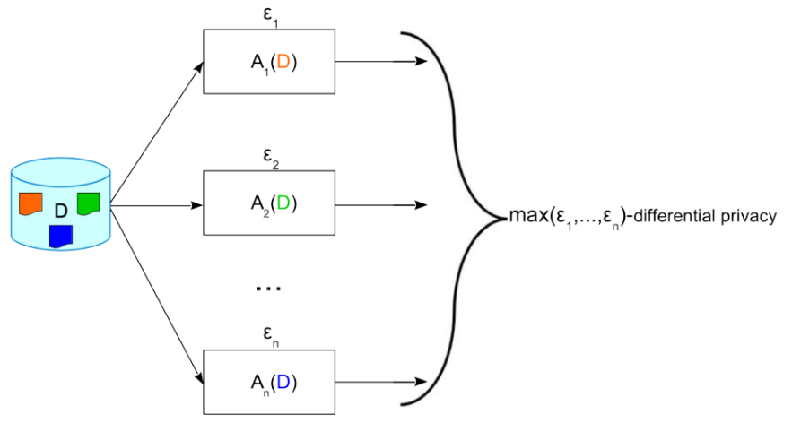
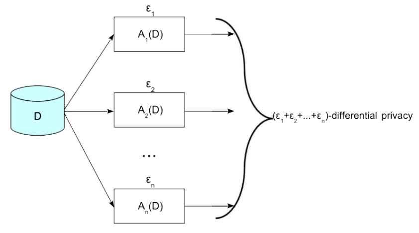
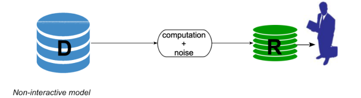
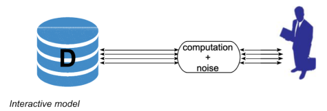

# Differential Privacy

Differential privacy è una proprietà matematica che garantisce che il risultato di un’analisi sia **indipendente dalla presenza o assenza di un singolo individuo nel dataset**: un attaccante che osserva l’output non deve essere in grado di distinguere se una specifica tupla è stata utilizzata nel calcolo di una statistica o meno.

  

#### DEF - Dataset Adiacenti
Dati due dataset questi sono adiacenti ($D \sim D'$) se:
$$||D-D'||_H \le 1$$

Cioè devono avere distanza di Hamming al massimo 1 (differiscono di al massimo una entry)

#### DEF - Differential Privacy
Un algoritmo randomized $\mathcal{M}$ soddisfa $\epsilon£-Differential Privacy se:
- Per tutte le coppie di dataset $D \sim D'$
- Per ogni possibile output $S \subseteq \text{Range}(\mathcal{M})$

Vale:
$$P[\mathcal{M}(D) \in S] \le e^\epsilon \cdot P[\mathcal{M}(D') \in S] $$

La distribuzione dei risultati ottenuti elaborando $D$ deve differire al massimo di un fattore $e^\epsilon$ di quella ottenuta elaborando $D'$.

> In sostanza si protegge l'individuo garantendogli **plausible deniability**

#### DEF - Global Sensitivity ($\Delta f$)
Dati:
- $\mathcal{D}$ universo dei possibili dataset
- $f$ funzione (query) di interesse
- $||...||_1$ norma $L_1$ (distanza di Manatthan)

La $L_1$-Global Sensitibity di una funzione $f:\mathcal{D} \to \R^k$ è definita come:
$$\Delta f = \max_{D, D' \text{ t.c. } D \sim D} ||f(D)-f(D')||_1$$

$\Delta f$ (GS) rappresenta la massima variazione possibile dell'output della funzione per qualsiasi coppia di dataset adiacenti nell'universo dei dati possibili.

### Selezione di $\epsilon$ (Privacy Budget)
Il parametro $\epsilon$ regola il trade-off tra sicurezza e utilità:
- $\epsilon \approx 0$ -  **Privacy totale, dati inutili**
    Si introduce una quantità eccessiva di rumore, che maschera totalmente i dati. Qualsiasi analisi è equivalente a dati randomici
- $\epsilon \approx 0$ - **Sweeet spot**
    
    Range ideale che dà forti garanzie di privacy mantenendo i dati utili e veritieri, standard di riferimento (poco rispettato)
- $\epsilon \gg 1$ - **Alta accuratezza, bassa privacy**

    Si introduce rumore minimo, i dati sono molto precisi ma si lede la granzia di indistinguibilità

  

#### Metodo di Laplace
Per query numeriche lo standard è il metodo di Laplace.

Prendiamo il dato rilasciato $M(D)$, in relazione all'originale $f(D)$:
$$M(D) = f(D) + \eta$$
Dove $\eta$ è un **elemento di rumore selezionato randomicamente** dalla distribuzione di Laplace, centrata in $0$ e con parametro di scala $b$:

$$\eta \sim \text{Lap}(b={\Delta f \over \epsilon}) $$

> In questo contensto $\sim$ indica 'segue la distribuzione di ...$

  

Il parametro $b={\Delta f \over \epsilon}$ mostra due relazioni:
- **Proporzionalità alla sensibilità**: più $f$ è sensibile (più l'individuo influenza il risultato) maggiore è il rumore richiesto epr nasconderlo
- **Proporzionalià inversa ad $\epsilon$**: al crescere di $\epsilon$ diminuisce il rumore ed il dato diventa più preciso (come detto prima)

##### ES

  

### Proprietà di Differential Privacy
#### Post Processing
Sia $M(D)$ il risultato di un algoritmo che soddisfa $\epsilon$-Differential Privacy,allora l'applicazione di una qualsiasi funzione $g$ su $M(D)$ non riduce le garanzie di privacy:
$$M \text{ soddisfa } \epsilon \text{-DP} \implies g(M(D)) \text{ soddisfa } \epsilon \text{-DP}$$

Quindi una volta che il dato è stato anonimizzato, è **sicuro per sempre**. Il post-processing può solo, nel caso peggiore, degradare l’utilità del dato o lasciarlo invariato, ma mai violare la privacy.

#### Composizione Parallela (Disjoint Dataset)
Se dividiamo un dataset $D$ in partizioni $D_1, D_2, ..., D_n$ cha non hanno intersezioni (ogni individuo appare in una sola partizione) ed eseguiamo un algoritmo $\epsilon$-DP su ognuno **il consumo di privacy non si somma**.

In questo caso la garanzia di privacy complessiva è pari al **massimo degli $\epsilon$ utilizzati**:
$$\epsilon_{tot} = \max(\epsilon_1, \epsilon_2, ... \epsilon_n)$$

  

#### Composizioen Sequenziale (Overlapping Dataset)
Nel caso di $k$ query consecutive sullo stesso dataset $D$ (o suoi sottoinsiemi che hanno righe in comune) **ogni query 'consuma' parte del privacy budget** (potenzialmente rivelo nuove info sugli stessi soggetti)

In questo caso la garanzia di privacy complessiva è la somma degli $\epsilon_i$ delle singole query:

$$\epsilon_{tot} = \sum_{i=1}^k \epsilon_i$$

  

Di conseguenza il privacy budget va trattato come una **risorsa limitata**, considerato il consumo di ogni query va stabilita una soglia massima oltre cui **ritirare permanentemente il dataset**.

#### Group Privacy
Differential Privacy estende (in misura ridotta) le sue garanzie ai gruppi di individui: le garanzie per l'individuo con parametro $\epsilon$ valgono per un gruppo di individui con parametro che degrada a $k\epsilon$.

La ragione è semplice: la sostituzione di un individuo cambia la distribuzione di un fattore $e^\epsilon$ allora la sostituzione di $k$ individui cambia la distribuzione di un fattore $e^{k\epsilon}$. Naturalmente più crescono le dimensioni del gruppo più le garanzie svaniscono.

### Modelli di rilascio
DP viene applicata diversamente a seconda delle modalità di rilascio dei dati

#### Modello Non Interattivo (Offline / Data Publishing)
Il Curator (chi detiene i dati) **decide a priori cosa rilasciare**:
- Il database originale $D$ viene elaborato con un algoritmo DP **una sola volta**
- L'output è un **oggetto statico** $R$

L’utente finale può quindi consultare $R$ infinite volte senza consumare ulteriore privacy budget ma la qualità dei dati è fissata all’inizio, non si possono effettuare analisi non previste dal rilascio $R$. 

  

#### Modello Interattivo (Online / Query-Response)
In questo caso i dati non vengono rilasciati pubblicamente:
- Il database $D$ rimane segreto 
- L'utente invia query al sistema
- Il sistema calcola la query ed aggiunge rumore sul momento (coputation + noise)

Questo modello offre massima flessibilità nelle query ma ognuna di esse consuma parte del privacy budget (analogo ad una composizione sequenziale).

  

## Differencial Privacy - Local vs Global
Nell'implementare DP è fondamentale differenziare dove si trovi il **trust boundary**

#### Global DP (Centralized)
Modello di cui ci siamo preoccupati finora:
- Gli utenti inviano **dati grezzi** al Data curator. Il rumore viene aggiunto al momento del rilascio
- Richiede **totale fiducia** nel Data Curator (che colleziona i dati in chiaro)

#### Local DP (Decentralized)
Modello standard per l'acquisizione di telemetrie dei dispositivi da parte dei grandi player:
- Gli utenti inviano **dati perturbati localmente prima dell'invio**
- Richiede **fiducia minima** nel Data Curator in quanto riceve dati già anonimizzati

Local DP richiede una quantità di dati molto maggiore per essere funzionale: sebbene la singola entry sia molto rumorosa nel contesto totale il rumore (accuratamente calibrato) tende a compensarsi, rivelando la vera statistica

#### DEF - Local DP
Un algoritmo randomizzato locale $\mathcal{M}$ soddisfa $\epsilon$-Local DP se:
- Per ogni coppia $(v, v')$ di possibili input segreti
- Per ogni possibile output $y$

Vale:

$$P[\mathcal{M}(v)=y] \le e^\epsilon \cdot P[\mathcal{M}(v)=y]$$

In sostanza il Data Curator non deve poter distinguere il singolo dato dell'utente.

## Inference Attack - Sensitive Value Distribution
Esiste comunque un possibile vettore d'attacco legato alla **forma della distribuzione complessiva dei dati**: anche se i dati dell'individuo sono anonimizzati l’aggregato può rivelare segreti riguardanti l’intera popolazione o l’organizzazione che li ha
generati.

##### ES
Immaginiamo di analizzare i record medici anonimi di una base militare:
- Se la distribuzione delle età mostra un picco sui 18-20 anni è probabile che si tratti di un campo di addestramento
- Se la distribuzione è spostata sui 40-50 anni è probabile che si tratti di un HQ

#### Mitigazione
Per contrastare queste inferenze sulle proprietà globali, è necessario implementare controlli specifici:
- **Identificazione delle correlazioni**: Capire a priori quali distribuzioni (es. età, genere) sono correlate a segreti strategici.
- **Analisi degli outlier**: Rilevare picchi anomali che potrebbero fungere da "firma" per l’identificazione della natura del dataset.
- **Limitazione dell’esposizione:**
    - Porre un tetto massimo al numero di tuple rilasciabili per certi attributi.
    - Misurare la distanza statistica tra la distribuzione rilasciata e quella attesa, bloccando il rilascio se la deviazione supera una certa soglia.

