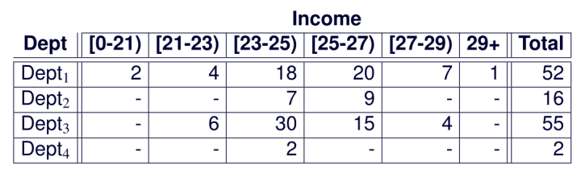
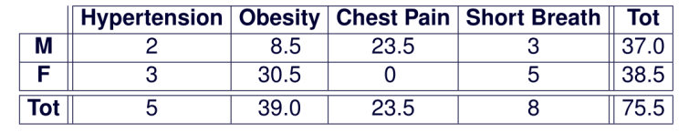
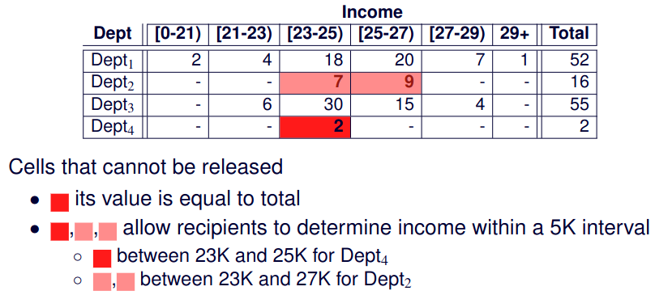
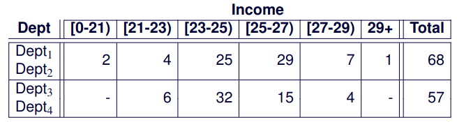
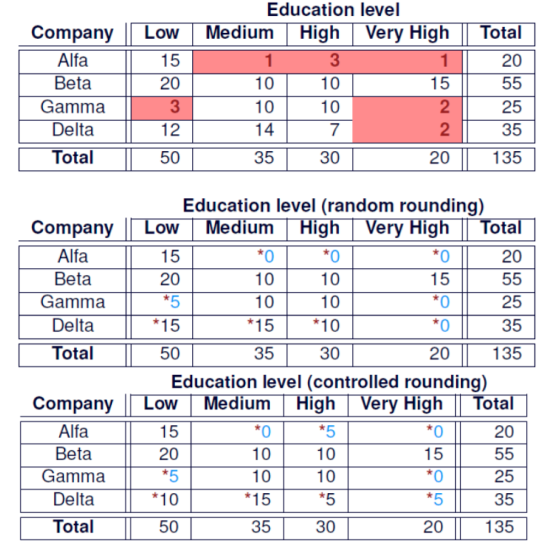
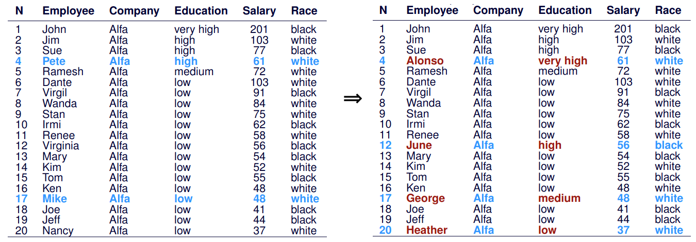
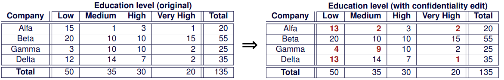
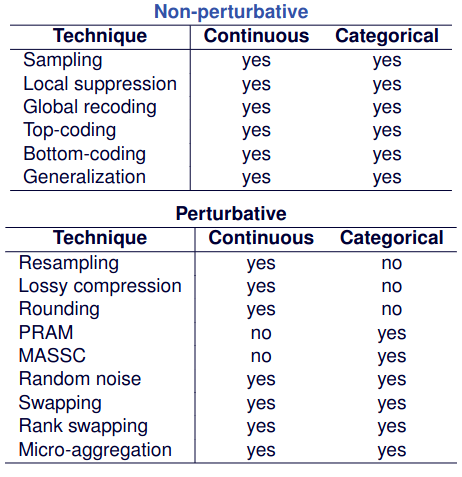
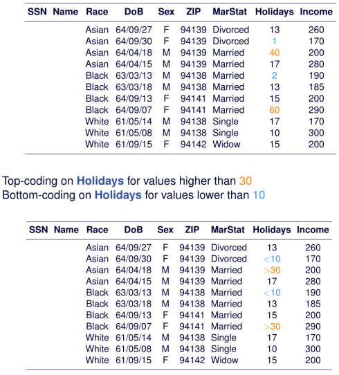

# Protezione di Macrodati e Microdati
## Protezione di Macrodati
I macrodati rappresentano fenomeni complessivi e di alto livello, spesso ottenuti tramite somma, aggregazione o generalizzazione di microdati. In questo modo, i dati originali perdono il loro dettaglio individuale e vengono trasformati in statistiche.

Possiamo classificarli in due categorie:
- **Tabelle di conteggio**: Misurano quanti elementi rientrano in una categoria. Le celle indicano il conteggio delle entità che possiedono un certo attributo.

  

- **Tabelle di magnitudo**: Misurano quanto vale un certo fenomeno. Le celle contengono una statisticaa estratta da variabili quantitative d’interesse.

  

> Il **totale marginale** della tupla corrisponde alla somma di tutti i valori presenti nelle celle.

Solitamente le tabelle di magnitudo vengono di solito rilasciate insieme alle corrispondenti tabelle di conteggio per:
- Garantire maggiore credibilità ai dati;
- Indicare il numero di soggetti da cui deriva il calcolo;
- Consentire di valutare la rilevanza statistica delle celle analizzate.

Per ridurre il rischio di reidentificazione si adottano un insieme di tecniche:
- Campionamento
- Rimozione degli identificatori
- Utilizzo di dettagli geografici molto generici
- Riduzione del numero di variabili rilasciate
- Non rilasciare dettagli sensibili o specifici

### Tecniche per la protezione di tabelle di frequenza
Partendo dall'assunzione che i totali marginali siano noti, si applicano più step:

1. Campionamento
2. Identificazione: Individuare quali celle possano essere sensibili e potenzialmente causare disclosure
3. Protezione delle celle sensibili
4. Verifica a posteriori

#### Campionamento
In questo caso si intende un campionamento statistico classico che risulti statisticamente corretto

#### Identificazione 
In questa fase si definiscono due tipi di regola:
- **Regole speciali**: stabilite ad hoc in base ai dati con cui si lavora. Servono a imporre una restrizione sul livello di specificità che può essere fornito nella tabella.
- **Regole di soglia**: una cella viene considerata sensibile se il suo valore è al di sotto di una soglia definita.

#### Protezione delle celle sensibili

**NB**: È fondamentale verificare che, dopo aver applicato le seguenti tecniche, la tabella rispetti le regole di soglia e le regole speciali.

##### Ristrutturazione della tabella
Consiste in un insieme di regole che permette di modificare la struttura della tabella, agendo su colonne e righe. Questa operazione può riguardare sia celle sensibili che non sensibili.

###### ES
> Special rule: Income within a 5K Euro interval

  

Possibile soluzione: Accorpiamo Dept$_1$ con Dept$_2$ e Dept$_3$ con Dept$_4$

  

##### Soppressione
La soppressione permette di cancellare le celle considerate sensibili, distinguiamo:
- **Soppressione primaria**: coinvolge solamente le celle che non soddisfano la soglia minima. I totali marginali possono permettere di ricavare comunque il valore delle
celle soppresse quindi la soppressione primaria da sola non è sufficiente.
- **Soppressione secondaria**: coinvolge l'intera tabella per rimuovere ulteriori celle oltre a quelle sensibili, in modo da impedire che i totali marginali consentano di ricostruire valori sensibili.

La soppressione algoritmica è un tema molto complesso spesso approcciato tramite programmazione lineare, stabilire se una soppressione secondaria è efficace non è scontato. Tendenzialmente possiamo cercare di ricostruire le celle soppresse attraverso sistemi di equazioni lineari.

##### Rounding
Per evitare la perdita di informazioni della soppressione, si può utilizzare la tecnica dell’arrotondamento dei valori, applicata a più livelli in relazione alla soglia di sensitività. I valori originali vengono sostituiti con un **multiplo di una base di arrotondamento** prefissata.

L’arrotondamento deve essere **non deterministico** e può seguire due strategie:
- **Random**: si decide casualmente se arrotondare i valori delle celle per eccesso o difetto. In questo caso, la somma dei valori nelle righe o colonne potrebbe differire dai totali marginali pubblicati
- **Controllato**: si arrotonda in modo tale da garantire che la somma dei valori delle celle corrisponda esattamente ai totali marginali. L’arrotondamento avviene comunque casualmente, ma i totali pubblicati restano coerenti. È più complesso da calcolare e non è detto che esista una soluzione

  

##### Confidentiality edit
In questo caso si decide di **alterare i dati di input delle statistiche** tramite **swapping** di informazioni delle tuple di microdati con quelle di dataset simili, con un limite determinato in base al gruppo di tuple in questione:
- Si stabilisce quali attributi non possono essere scambiati
- Per ogni record da scambiare si cercano tuple con caratteristiche simili negli attributi da non scambiare
- Si scambiano le tuple matchate
Lo swapping deve preservare i risultanti toatali marginali

Il numero di tuple da swappare è in pecentuale più alto per gruppi piccoli
###### ES
Presi i record dei dipendenti di un'azienda, per costruire una tabella statistica sui livelli di istruzione, applichiamo confidentiality edit al 10% dei record:
- Fissiamo le altre variabili
- Swappiamo con record provenienti da altre aziende

  

I risultanti macrodati riflettono l'applicazione di confidentiality edit:

  

### Tecniche per la protezione di tabelle di magnitudo - Soppressione Primaria
Le tabelle di magnitudo richiedono un approccio diverso per la protezione: le celle sono rappresentative dell'aggregato della popolazione statistica, tuttavia **valori estremi** le influenzano maggiormente risultando più vulnerabili. L'obiettivo è quindi tutelare questi individui senza escluderli dalla statistica.

Si seguono gli stessi step:
1. Campionamento
2. Identificazione: Individuare quali celle possano essere sensibili e potenzialmente causare disclosure
3. Protezione delle celle sensibili
4. Verifica a posteriori

#### Campionamento
Si applicano le stesse tecniche descritte nel paragrafo precedente

#### Identificazion
##### $p$-Percent
Identifichiamo celle sensibili verificando se non sia possibile stimare (per eccesso o difetto) il valore reale non abbia un errore inferiore alla soglia $p$.
Dati:
- $N$ numero di rispondenti per una cella
- $x_1, ... x_N$ valori dei rispondenti in ordine decrescente
- $c$ dimensione della **coalizione** di rispondenti interessati a stimare $x_1$

Una cella è **protetta** se:
$$\sum_{i=c+2}^N x_i \ge {p \over 100} x_1$$

Sostanzialmente verifichiamo se in caso di collusione di $c$ rispondenti (assumiamo quelli che contribuiscono maggiormente dopo il primo) i rimanenti elementi hanno peso sufficiente per mascherare $x_1$ con errore almeno $p$.

###### ES

ID| Name | Income |
:---:| :---: | :---: |
$x_1$ | Alice | 100K |
$x_2$ | Bob | 80K |
$x_3$ | Carol | 30K |
$x_4$ | David | 20K |
$x_5$ | Eve | 10K |
$x_6$ | Frank | 3K |
| ... | ... | ... |

Gli elementi di questa tabella contribuiscono ad una cella di total income con totale 250k

Presi:
- Una coalizione di 3 elementi ($x_2, x_3, x_4$, maggiori contributori dopo Alice)
- Soglia di errore del $20\%$

$$\sum_{i=5}^N x_i \ge {p\cdot100 \over 100} \to p \le Cell-\sum_{i=1}^4 x_i \to p \le 250 - (100+80+30+20) \\ \to p \le 20 $$ 

La cella risulta quindi protetta.

##### Regola $pq$
A differenza di $p$-percent, $pq$ **considera il livello di conoscenza preliminare** dei rispondenti, attribuendogli un valore $q$ corrispondente alla percentuale di errore della stima da parte degli altri rispondenti.

Dati:
- $N$ numero di rispondenti per una cella
- $x_1, ... x_N$ valori dei rispondenti in ordine decrescente
- $c$ dimensione della **coalizione** di rispondenti interessati a stimare $x_1$

Una cella è **protetta** se:
$$\sum_{i=c+2}^N x_i \ge {p \over q} x_1$$

Segue la stessa logica di $p$-percent ma modella il margine di errore dei rispondenti collusi ($100\%$ in $p$-percent)

##### Regola $(n, k)$ (Dominance rule)
Se un gruppo di $n$ elementi contribuisce ad almeno il $k\%$ del totale è da considerarsi **sensibile**. Il parametro $n$ viene selezionato in modo da essere **maggiore rispetto al numero di una possibile coalizione** sospettata. Valori tipici si aggirano intorno a $(n=3, k=70\%)$

Intuitivamente se una cella è dominata da un piccolo gruppo di rispondenti il suo valore serve solo da **upper estimate dei loro dati**.

##### ES
Gli elementi di questa tabella contribuiscono ad una cella di total income con totale 250k

ID| Name | Income |
:---:| :---: | :---: |
$x_1$ | Alice | 100K |
$x_2$ | Bob | 80K |
$x_3$ | Carol | 30K |
$x_4$ | David | 20K |
$x_5$ | Eve | 10K |
$x_6$ | Frank | 3K |
| ... | ... | ... |

Assumendo $(n=2, k=70\%) \to 180/250 \le 70 \to 72 \le 70$, la cella è da considerare sensibile.

> **NB**
> Per tutte le tecniche descritte è tassativo **mantenere i parametri segreti**, viceversa si rischia che sia possibile ricostruire i valori originali.

### Tecniche per la protezione di tabelle di magnitudo - Soppressione Secondaria
Una volta identificate le celle sensibili, ci sono due opzioni principali per proteggerle:
- Ristrutturare la tabella unificando celle fino a quando non rimangono celle sensibili
- Sopprimere le celle attraverso soppressioni primaria e fare soppressioni secondarie per evitare che i dati dei rispondenti
possano essere stimati con eccessiva precisione

Le celle sensibili possono comunque essere esposte indirettamente a causa di:
- Pubblicazione implicita di unioni di celle soppresse, che possono diventare sensibili a seconda della regola adottata
- Possibilità di risolvere le equazioni rappresentate dalle righe e colonne della tabella pubblicata

> Un metodo alternativo per evitare la soppressione consiste nell’ottenere autorizzazione scritta dai rispondenti

### Tecniche di audit
Per garantire la protezione, è necessario applicare la regola di sensibilità anche alle somme marginali. Inoltre considerando righe e colonne come un sistema di equazioni lineari, per ogni cella soppressa si stimano un limite inferiore e superiore utilizzando tecniche di programmazione lineare (computazionalmente complesso per grandi tabelle).

##### Perdita di informazione
La selezione delle celle complementari dovrebbe essere effettuata in modo da minimizzare la perdita di informazione. Due esempi di euristiche basilari sono:
- Minimizzare la somma dei valori soppressi, privilegiando la soppressione di celle con valori piccoli
- Minimizzare il numero totale di celle soppresse, per mantenere la tabella il più completa possibile

## Protezione di Microdati
I microdati sono intrinsecamente più esposti e rischiosi rispetto ai dati aggregati, poiché contengono informazioni dettagliate a livello individuale.

  

### Tecnche non perturbative
##### Campionamento
La tabella di microdati viene generata selezionando casualmente tra i rispondenti. Poiché non è certo se un determinato rispondente sia incluso nel campione, il rischio di re-identificazione si riduce significativamente.

##### Soppressione Locale
Rimuovere o sostituire valori sensibili con valori mancanti, in particolare per gli outlier o i valori unici che potrebbero consentire l’identificazione di un individuo.

##### Global Recording
Il dominio degli attributi viene **suddiviso in insiemi disgiunti** e a ciascuno di questi un'etichetta corrispondente all'intervallo in cui ricade il valore originale.

##### Top/Bottom-Coding
Tecniche aiutano a prevenire la re-identificazione dei rispondenti attraverso valori estremi, entrambe applicabili sia valori categorici che continui
- **Top-coding**: definisce un **limite superiore per ogni attributo da proteggere**. Qualsiasi valore che superi questo limite viene **sostituito con un indicatore** che segnala che il valore originale eccede tale soglia. - **Bottom-coding**: analogamente, definisce un **limite inferiore**. I valori al di sotto di questo limite vengono sostituiti con un indicatore che segnala il bottom-code

  

##### Generalizzazione
La generalizzazione dei dati consiste nel sostituire i valori originali con valori più generali, riducendo il livello di dettaglio per proteggere la privacy dei rispondenti (vedi appunti precedenti per maggiori dettagli).

### Tecniche perturbative
##### Random noise
Consiste nel perturbare un attributo sensibile modificandone il valore tramite l’aggiunta o la moltiplicazione con una variabile casuale scelta secondo una distribuzione prestabilita.

##### Swapping
Consiste nel selezionare una piccola percentuale di record e abbinarli ad altri record presenti nello stesso file (eventualmente in diverse aree geografiche), sulla base di un insieme di variabili prestabilite. Successivamente, i valori di tutte le altre variabili vengono scambiati tra i due record

##### Blurring/Micro-Aggregation
Consiste nel raggruppare tuple individuali in piccoli gruppi di dimensione fissa $k$ e pubblicare la media dei valori del gruppo invece dei valori individuali. I gruppi vengono formati seguendo criteri di massima somiglianza tra i membri, in modo da preservare la coerenza statistica.

Esiistono diverse varianti della micro-aggregazione:
- La media può sostituire il valore originale solo per una tupla specifica del gruppo o per tutte le tuple del gruppo
- Diverse variabili possono essere protette attraverso la micro-aggregazione, applicando lo stesso criterio di raggruppamento o criteri differenti per ciascun attributo

