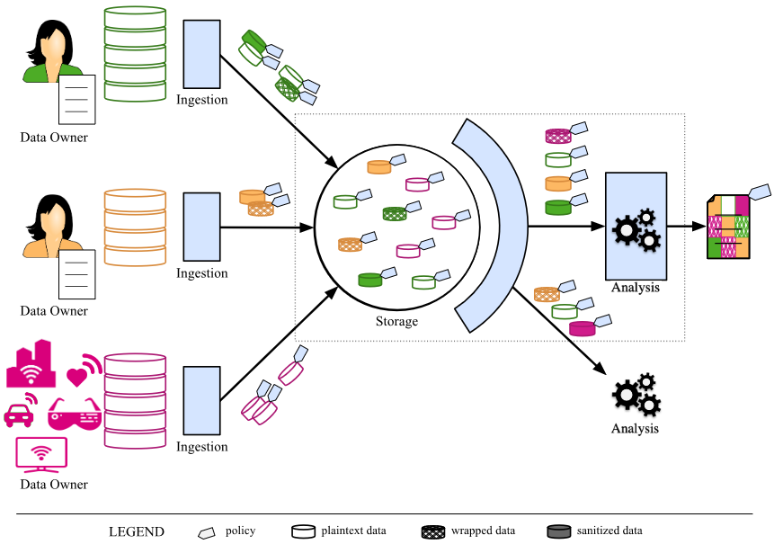
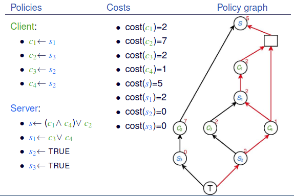
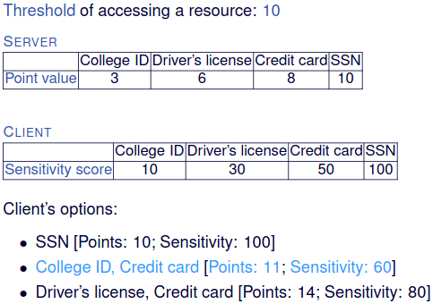
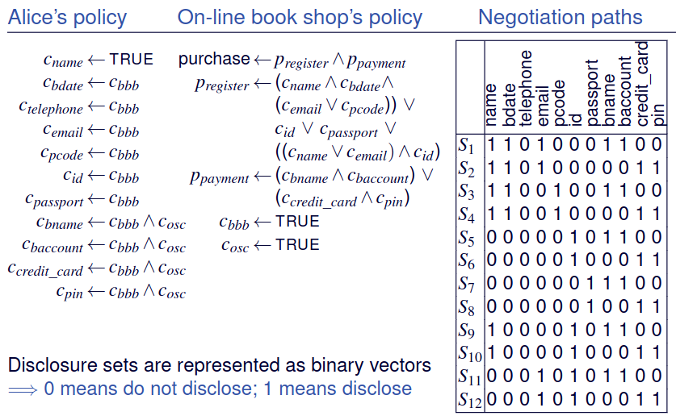
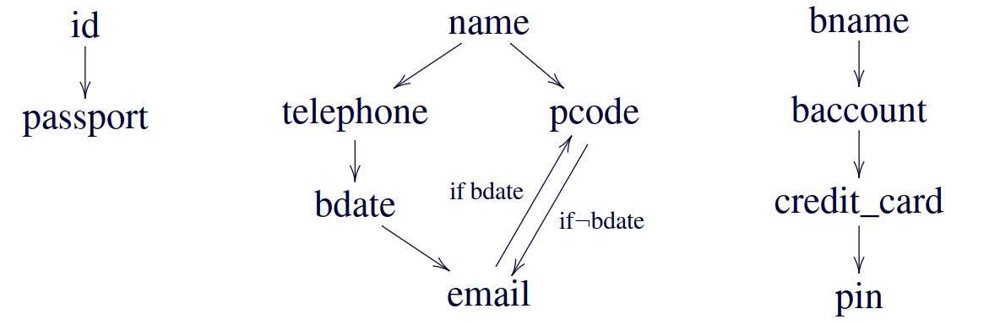
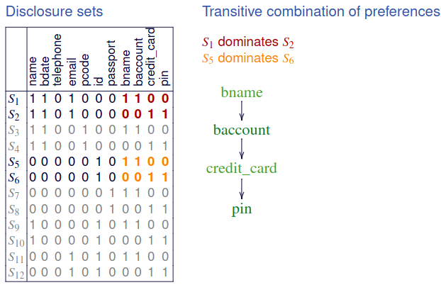
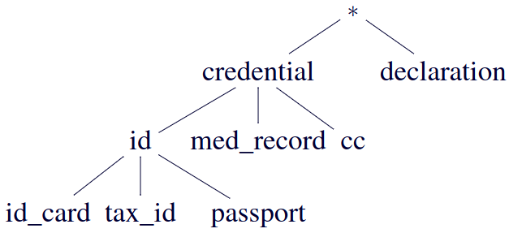
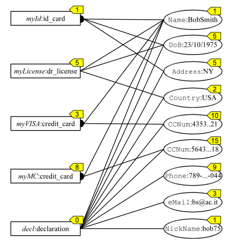
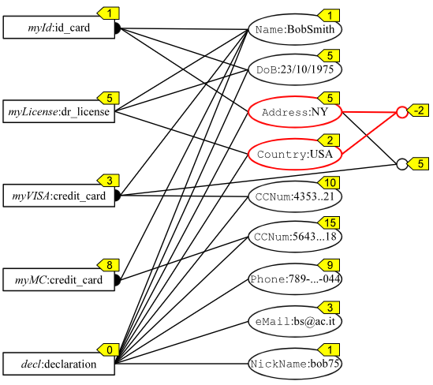
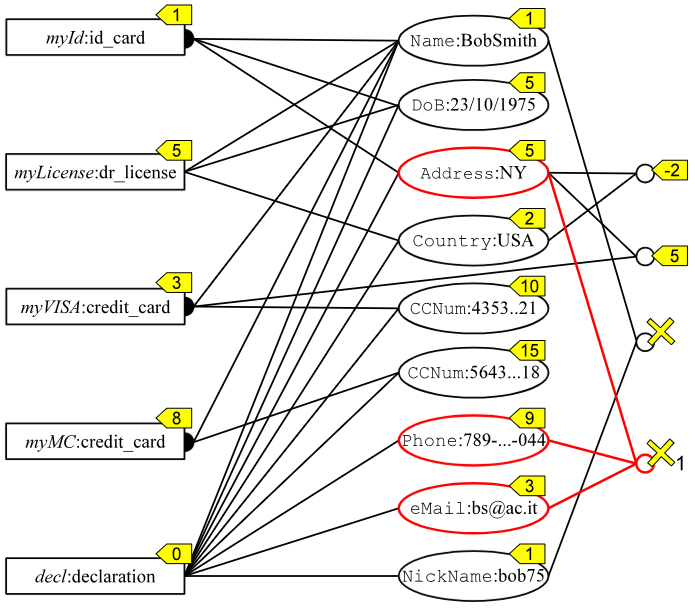

# Privacy nel Cloud
Per rendere la condivisione di dati e computazione collaborativa attraverso il cloud sicure è necessario stabilire un framework di lavoro

  

##### Requisiti
É necessario esprimere formalmente requisiti e policy di accesso, condivisione, uso e processing dei dati. I requisiti possono avere provenienza varia (utenti, regolamentazioni di privacy, regole aziendali).

Difficilmente ci si può assicurarr che il cloud provider rispetti queste policy, è più intelligente un approccio "embedded privacy", il dato arriva sul cloud in una forma che già rispetta le policy.

##### Strumenti per l'enforcement
Sono ovviamente necessari strumenti che possano attuare le policy, esempi banali sono la crittografia o la sanitizzazione dei dati (trasformazione che riduce sensibilità).

##### Enforcement
Effettiva applicazione delle policy durante tutto il ciclo di vita dei dati (ingestion/storage/analysis) attraverso appropriati strumenti e meccanismi di verifica.

## Tutela dell'utente
L'obiettivo è mantenere confidenziale l'identità dell'utente durante le sue interazioni col cloud. Distinguiamo due aspetti della protezione:
- **Rilascio diretto**: regola come quando e perchè un utente rilascia informazioni
- **Utilizzo secondario dei dati**: regola l'uso che 2nd party possono fare dei dati e come questi possano essere rilasciati

### Policy di Accesso
In contesto cloud è fondamentale stabilire politiche di accesso mindful sulla privacy basate su policy ben definite. Distinguiamo a priori due approcci di negoziazione:
- **Interactive**: un client risponde progressivamente ai requisiti richiesti ("passa un documento alla volta"). Diventa problematica per l'utente perchè è costretto a continuare a rispondere senza sapere cosa è ulteriormente richiesto per ottenere l'accesso e porta a potenziale eccesso di disclosure da parte sua
- **Policy based**: il server risponde ad una richiesta con tutti i requisiti richiesti perchè sia servita. Sconveniente per il server che è costretto a rivelare le proprie policy senza sapere con chi sta interagendo

In casi reali si utilizza un'ibridazione dei due.

#### Preferenze dell'utente
In generale vorremmo che un sistema di access contol dia la possibilità all'utenze di esprimere preferenze sulla disclosure di vario tipo:
- **Context-based preferences**: divulgazione vincolata al contesto e al destinatario.
- **Forbidden disclosures**: divieto di rilasciare contemporaneamente determinati dati.
- **Sensitive associations**: combinazione di dati più sensibile dei singoli elementi.
- **Limited disclosure**: rilascio di una proprietà generica anziché del dato esatto.
- **Instance-based preferences**: preferenze basate su valori specifici dell'attributo.
- **History-based preferences**: preferenze basate sulle informazioni già condivise in precedenza.
- **Proof-based preferences**: preferenza nel provare il possesso di un dato invece di rilasciarlo.
- **Non-linkability preferences**: preferenza per i dati che minimizzano l'identificabilità dell'utente.

### Strategie di negoziazione
#### Cost Sensitive Trust Negotiation
Associa ad ogni credenziale e policy un costo che scala col livello di sensitività. L'obiettivo è minimizzare il costo per entrambe le parti. Possiamo rappresentare la negoziazione come un grafo.

Il problema si riduce quindi alla ricerca di un percorso con costo minimo.

Questo approccio presenta una serie di limiti:
- Si concentra esclusivamente sulla negoziazione
- Minimizzare il costo totale non offre particolari vantaggi in molti casi reali
- Il calcolo dei costi come somma è una scelta potenzialmente rischiosa: l'information gain della combinazione di informazioni è tendenzialmente maggiore alla loro somma
- Va costruito un'albero efficiente che non abbia (o minimizzi) cammini inutili che garantiscono l'accesso con maggior disclosure di altri, particolarmente rilevante in casi di negoziazione interattiva (non 'vedo' cosa c'è più avanti nel cammino)
- Supporta solo credenziali a grana grossa (non singole proprietà): non supporta associazioni sensibili, rilasci proibiti o credenziali la cui sola esistenza è sensibile

###### ES

  

#### Point-Based Trust Management
Server e client associano ad ogni credenziale un punteggio (solitamente pubblico per il server), il server richiede un punteggio minimo per accedere ad un servizio. I due punteggi sono svincolati e rappresentano il livello di trust dalla prospettiva del server e la sensitività dalla prospettiva del client

Il problema diventa quindi l'equivalente di knapsack (minor disclosure per maggior trust), risolto in collaboarazione dalle due parti utilizzando crittografia omomorfica per preservare i parametri.

Anche questo approccio ha molti limit in comune con l'esempio precedente:
- Si concentra esclusivamente sulla negoziazione
- Modella solo l'additività della privacy, come nel precedente caso non consideriamo l'information gain delle informazioni in combinazione
- Server e client devono accordarsi sui possibili tipi di credenziale, rischiando di compromettere la confidenzialità delle policy del server
- Supporta solo credenziali a grana grossa (non singole proprietà): non supporta associazioni sensibili, rilasci proibiti o credenziali la cui sola esistenza è sensibile

###### ES

  

#### Logic-based minimal credential disclosure
Applicabile a contesti di trust negotiation in cui il rilascio di credenziali e regolato da policy.
Ogni credenziale è modellata come un singolo attributo e attraverso il matching tra le policy delle due parti troviamo un set che raccoglie più path di negoziazione. Si utilizza logica del primo ordine per specificare le preferenze di pivacy.

Otteniamo quindi una matrice che rappresenta le disclosure richieste per accedere ad un certo servizio. Possiamo confrontare i disclosure set (righe) attraverso la **composizione di Pareto** ($\succ_p$), scegliendo quello che domina tutti gli altri (è uguale o migliore in tutte le componenti ed ha almeno un componente migliore).
In questo contesto consideriamo migliore la non disclosure (0), formalmente $0 \succ_i 1$

###### ES

  

Possiamo espandere questo paradigma introducendo **gerarchie** (preferibilmente contestuali) che descrivano le preferenze di disclosure dell'utente ($c_i \to c_j$ indica che l'utente preferisce rilasciare $c_i$ a $c_j$):

  

Possiamo quindi **combinare le preferenze in modo transitivo**: un disclosure set contenente $\textt{b_name}$ piuttosto che $\textt{credit_card}$ e $\textt{pin}$

###### ES

  

### Privacy portfolio
Il modello privacy portfolio mira a fornire metodologie di modellazione più avanzate per le policy i disclosure da parte dell'utente e supportarle durante i processi di autenticazione.

Il privacy portfolio di un utente è composto da:
- **Credenziali**: **certificati prodotti e firmati da terzi**, rappresentati come un set di proprietà con un tipo, un identificatore e un issuer
- **Dichiarazioni**: proprietà trattate come **credenziali self-signed**, hanno set di proprietà più eterogenei

Possiamo definire un ordinamento dell'astrazione delle credenziali $\mathscrl{H}(\mathscr{I}, \preceq_{isa})$:

  

Le entry del portfolio possono essere classificate come:
- **Credential indipendent**: il valore dipende esclusivamente dall'owner delle credenziali
- **Credential dependent**: il valore dipende da un ente di certificazione

Distinguiamo le proprietà delle credenziali tra:
- **Atomiche**: rilasciate per intero
- **Non atomiche**: possono essere rilasciate selettivamente e/o può essere rilasciata froof of possession

##### DEF - Disclosure
Una disclosure è un subset del portfolio che soddisfa:
- **Certificabilità**: ogni proprietà è certificata da una credenziale
- **Atomicità**: se una proprietà di una credenziale atomica viene rivelata allora tutte le sue proprietà sono rivelate

##### DEF - Portfolio sensitivity
Possiamo associare ad ogni componente del portfolio una sensitivity label per esprimere i privacy requirements:
- $\lambda(A)$: sensitività della **proprietà** $A$ presa individualmente
- $\lambda(c)$: sensitività dell'esitenza della credenziale $c$

Definiamo inoltre:
- Una relazione di ordine parziale $\succeq$
- Un operatore arbitrario di composizione $\bigoplus$ ($\lambda_1 \bigoplus \lambda_2$ è a sua volta una sensitivity label), nel nostro caso assumiamo le label in $\N$ e composte tramite $+$

###### ES

  

Un'associazione $A = {A_i, ..., A_j, c_k, ..., c_n}$ può avere sensitività $\lambda(A) = A_i \bigoplus ... \bigoplus A_j \bigoplus c_k \bigoplus ... \bigoplus c_n$ può essere:
- Maggiore del rilascio di ogni elemento in $A$: Modella una sensitive wiew (ie. Nome + DoB)
- Minore del rilascio di ogni elemento in $A$: Modella dipendenza tra i suoi elementi (ie. Città + Paese di Residenza)

###### ES

  

Possiamo inoltre definire dei **costraint** per $A = {A_i, ..., A_j, c_k, ..., c_n}$:
- **Forbidden view**: il rilascio di $A$ è proibito
- **Disclosure limitation**: possono essere rilasciati al massimo $n$ elementi di $A$

###### ES

  

Consideriamo $\lambda(\mathscr{D})$ di una disclosure $\mathscr{D}$ come la somma delle sensitivity label di proprietà, credenziali, ed associazioni che la compongono.

##### DEF - Richiesta Server
Modelliamo una richiesta $\mathscr R$ come una disgiunzione di richieste semplici. Una **richiesta semplice** è una congiunzione di termini
###### DEF - Termine
Un **termine** $r=\texttt{cred\_type.}\{A_1, \dots, A_m\}$ rappresenta la disclosure di $\{A_1, \dots, A_m\} \in c$ t.c. $\texttt{cred\_type}(c) \succeq_{\text{is\_a}} \texttt{cred\_type}$ 

$\to \texttt{cred\_type}$ è un'astrazione di una credenziale di tipo $\texttt{cred\_type}(c)$

###### DEF - Disclosure
Una **disclosure** $\mathscr{D}$ soddisfa $\mathscr R$ se soddisfa almeno un $R$ in $\mathscr R$:

$\forall r=\texttt{cred\_type.}\{A_1, \dots, A_m\} \in R$ include $c$ t.c.:
- $c$ certifica $\{A_1, \dots, A_m\}$
- $\texttt{cred\_type}(c) \succeq_{\text{is\_a}} \texttt{cred\_type}$

Sostanzialmente una richiesta è una disgiunzione di insiemi di attributi richiesti dal server ed una disclosure deve fornire almeno uno di questi e relative certificazioni.

###### DEF - Disclosure Minima
Una disclosure è **minima** se $\not\exists \mathscr{D}'$  disclosure valida t.c. $\mathscr{D}'$ soddisfa $\mathscr{R} \land \lambda(\mathscr{D}') < \lambda(\mathscr{D})$ 

Computare la disclosure minima è NP-hard, si possono sfruttare:
- La rappresentazione di portfolio e richieste come grafo per applicare euristiche di graph matching
- La rappresentazione come problema Max-SAT e relativi solver
