# Cloud Privacy
In contesti di storage remoto (outsourcing dei dati) è fondamentale preoccuparsi della postura del provider che li detiene per noi. Identifichiamo tre tipologie:
- Curious
- Lazy
- Malicious

Le soluzioni si basano su:
- Encryption
- Fragmentation
- Encryption + Fragmentation

## Encryption
Adatte a provider 'honest but curious', i dati sensibili vengono protetti tramite encrytpion. Ovviamente è necessario preservare l'utilizzabilità del dato, tre possibili approcci fine-grained sono:
- Ricerca keyword-based su dati criptati (richiede crittografia che la supporti)
- Crittografia omomorfica (molto lenta)
- Schemi di encryption 'a cipolla' in cui ogni livello supporta tipi di operazioni diverse (aggiunge parecchio overhead)
- Indexing attraverso metadata che consentono al server operazioni fine-grained (in abbinamento alla crittografia)

### Indexing
Abbiniamo ai dati (criptati in storage) index che consentono al server di eseguire query. Richiedono l'implementazione di query engine sia lato utente che lato server. Gli index possono coinvolgere una sola colonna o un gruppo di esse

  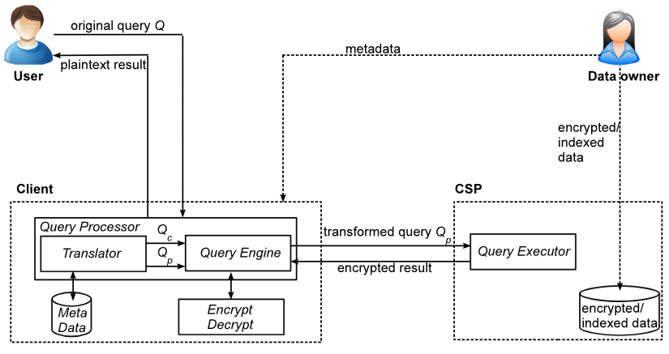

#### Strategie di indexing
##### Direct (1:1)
- Utilizza come index il valore reale o un suo encoding
- Molto semplice e preciso per query di uguaglianza
- Vulnerabile a inference attack: il dato originale rimane distinguibile 

  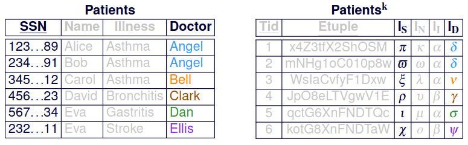

##### Bucket (N:1)
- Raggruppa N valori in un unico index (secondo partizionamento o hashing) i bucket possono essere stutturati come:
    - Equi-width: ogni bucket copre lo stesso range (più vulnerabile a frequenct analysis)
    - Equi-depth: ogni bucket contiene circa lo stesso numero di record (soffre l'inserimento di nuovi dati fino a dover richiedere ripartizionamento)
- Supporta query di tipo $\texttt{attribute <op> attribute}$ e $\texttt{attribute <op> value}$ con $\texttt{<op>} \in {=, <, >,\le, \ge} (gli elementi a confronto devono condividere la stessa funzione di indexing):
    - Query di uguaglianza:
        - Ritrona tutti gli index associati al valore
    - Query di ordinamento:
        - Se l'indexing è **order-preserving** (con partizionamento): ritorna gli index dei bucket che contengono valori nel range richiesto
        - Se l'index è **random**: ritorna tutte le partizioni in cui potrebbero risiedere valori che soddisfano la condizione (richiede di computare molti hash se l'hashing non è order preserving)
- Richiede post-processing: il server potrebbe restituirci tuple spurie (non coinvolte nella query ma in bucket di query che ci interessano)
- Rimane vulnerabile ad inference attack tramite più vettori:
    - **Frequency analysis**: la distribuzionde delle tuple nei bucket potrebbe riflettere quella del dominio a seconda di come li strutturiamo
    - **Range reveal**: Se i bucket hanno indici ordinabili un attaccante può ricostuire i bound del bucket
    - **Pattern analysis**: Anche se i bucket sono casuali un attaccante può ricostruire la topologia dei bucket
- Richiede di bilanciare correttamente il tradeoff tra sicurezza e performance: bucket molto grandi sono più sicuri ma ritornano molte più query spurie

  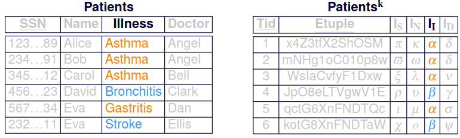

##### Flattened (1:N)
- Mappiamo un valore ad N index, tipicamente ottenuto tramite **salting** dell'hash (introduciamo collisione tra gli index)
- Consente solo query di uguaglianza: non consente di eseguire query di confronto sul server
- Richiede un pre-processing per le query, rendendole più impegnative: devo richiedere al server tutti gli index a cui è mappato il valore (e solitamente anche altri randomici per mascherare l'associazione tupla-indice)
- Produce più query spurie
- Impedisce molti dei vettori di inference attack: non è più possibile fare inferenze basate sulla distribuzione degli indici
- Rimane vulnerabile a pattern analysis: la stessa query eseguita più volte richiede sempre gli stessi indici

  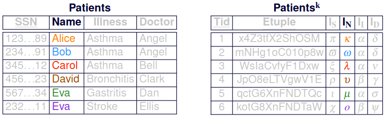

##### Multi-Dimensional Flattening (N:M)
- Combina bucketing e flattening, mappiamo N valori ad M index (introduciamo collisione tra valori e più index per valore)
- Supporta solo query di uguaglianza lato server
- Garantisce il livello maggiore privacy per strategie basate su indexing: immune a frequency analysis e resitente a pattern analysis
- Richiede che il client conservi una mappa degli index (potenzialmente rischioso) per il query engine
- L'overhead scala molto rapidamente: richiede molto pre e post processing e ritorna molte tuple spurie
- L'inserimento di nuove tuple è costoso (in certi casi richiede restructuring)

###### $k$-flat indexing
Partiziona le tuple in gruppi di dimensione $k$ (o $k+1$), sfruttando la rappresentazione spaziale delle tuple per l'indexing (analogo a Mondrian).

La partizione avviene ricorsivamente attraverso tagli dello spazio:
- Ad ogni step taglia in corrispondenza del valore che separa i due subset massimi (circa a metà)
- Verifica il taglio: la cardinalità dei subset differisce al massimo di 1

Le tuple appartenenti allo stesso subset devono avere la stessa combinazione di valori di index. Costruiamo una mappa che associa ad ogni subset i range di valori che copre per ogni attributo.

Possiamo decidere se definire gli indici della mappa come:
- **Value-based**: gli indici sono computati in base alla coverage (ci consente di eseguire le query sul server)
- **Group-based**: gli indici sono computati in base al group id
    - Per le query richiede:
        - Client: la mappa valore-gruppo
        - Server: relazione blocco criptato - index del blocco

  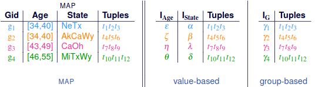

Nell'esecuzioen di una query recuperiamo i blocchi interessati lato client, li si richiede al server e si computa la query sul client

### Esposizione ad inferenza
Misuriamo quantitativamente il livello di esposizione tramite il **coefficiente d'espozizione** $\epsilon$, dipendente da due fattori:
- Il metodo di indexing adattato
- La conoscenza a priori dell'attaccante:
    - Freq+DB{^k}: la distribuzione dei valori originali e il database criptato
        - Può ricostruire il contenuto del database
        - Può ricostruire la funzione di indexing
    - DB+DB{^k}: il database originale e criptato
        - Può ricostruire la funzione di indexing

#### Indexing Diretto
##### Freq+DB{^k}
La corrispondenza valore-index può essere esposta dal suo numero di occorrenze. Occorrenze che appartengono alla stessa classe di equivalenza $C$ (hanno index uguali)  è:
$$\epsilon_C = {1 \over |C|}$$

###### ES

  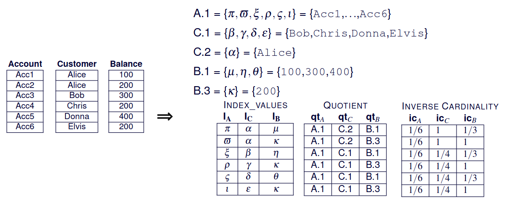

In questo esempio:
- La lettera indica l'attributo
- Il numero indica il numero di occorrenze

Calcoliamo quindi l'$\epsilon$ complessivo della tabella come (un average dell'$\epsilon$ di tutte le tuple, considerando tutti gli index):
$$\mathscr{E} = \frac{1}{n} \sum_{i=1}^{n} \prod_{j=1}^{k} \mathrm{IC}_{i,j} = 1/18$$

##### DB+DB$^k$
Modelliamo l'inferenza come un **grafo Row-Column-Value** composto da:
- Un vertice 'riga' per ogni tupla
- Un vertice 'colonna' per ogni attributo
- Un vertice per ogni valore distinto nella colonna
- Un arco che connette ogni valore alle righe/colonne in cui appare

Essendo i grafi RCV di plaintext e criptato identici misuriamo $\epsilon$ come **omomorfismo** tra i due.

Il set degli automorfismi contiene gruppi descritti dalla **partizione equivalente più grossolana dei vertici** (che racchiude il maggior numero di vertici indistinguibili): tutti i subset della partizione contiene vertici che possono essere scambiati tra di loro nell'automorfismo (sono equivalenti per topologia ma non etichetta).

La probabilità di identificare un vertice nella partizione $C$:
$$\epsilon_C = {1 \over |C|}$$

L'$\epsilon$ totale della tabella, considerando $n$ partizioni equivalenti ed $m$ etichette:
$$\mathscr{E} = {n \over m}$$

###### ES

  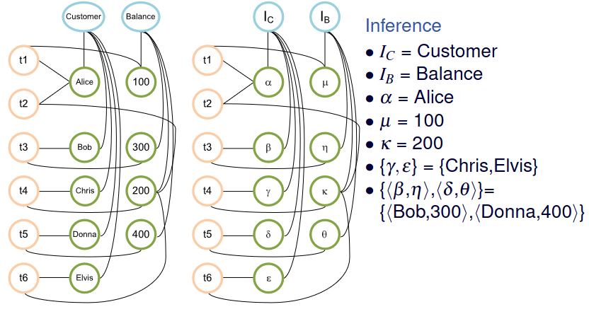

## Fragmentation + Encryption
Considerando che l'encryption è costosa dal punto di vista computazionale e l'elemento più sensibile è l'associazione tra i valori piuttosto che i valori in sè introduciamo fragmentation per rompere l'associazione invece che affidarsi esclusivamente all'encryption.

Definiamo i costraint su:
- **Attributi sensibili**: singleton ie. ${Email}, {Name}$
- **Associazioni sensibili**: non singleton ie. ${DoB, Name}$
Per rispettare i constraint i frammenti devono risiedere su **server distinti non comunicanti**.

I constraint $\mathscr{C}$ sulla relazione $R$ sono garantiti frammentando $R$ in $\lang R_1, R_2, E \rang$:
- $R_1$ ed $R_2$ includono un tuple id per garantire che la frammentazione sia lossless
- $R_1 \cup R_2 = R$
- $E$ è il set di attributi criptati ed $E \subseteq R_1, E \subseteq R_1$
- $\forall c \in $\mathscr{C}, c \not \subseteq (R_1 \setminus E) \land (R_2 \setminus E)$

  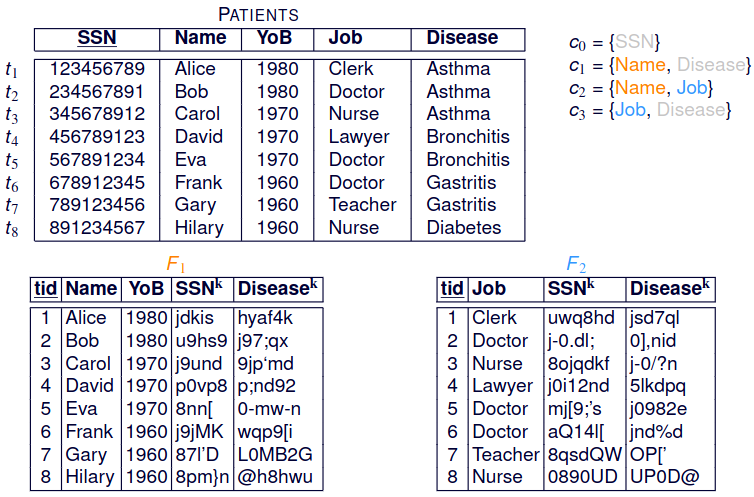

#### Query execution
L'esecuzione delle query richiede che sia eseguita in qualche forma su entrambi i server, possiamo prendere due strade:
- Inviare subquery ad entrambi e fare il join dei risultati sul client
- Inviare una subquery ad uno dei due ed usare i tuple id del risultato per un semi-join con i risultati della query sull'altro

##### Optimal Query Decomposition
Per identificare la **decomposizione ottima** di una query sfruttiamo le **matrici di affinità**:
- $M_{i,j}$: costo per lo storage degli attributi $i$ e $j$ in plain text su frammenti separati
- $M_{i,i}$: costo per lo storage dell'attributo $i$ criptato su entrambi i frammenti

L'obiettivo è quindi minimizzare:
$$\sum_{i,j : i \in (R_1 - E), j \in (R_2 - E)} M_{i,j} + \sum_{i \in E} M_{i,i}$$

Questo è un problema equivalente alla **colorazione di un ipergrafo**. Data una relazione $R$ il grafo $G(R)$:
- Gli attributi sono vertici
- Gli archi $(i,j)$ hanno peso $M_{i,j}$
- I vertici $i$ hanno peso $M_{i,i}$
- I constraint $\mathscr C$ rappresentano un ipergrafo $H(R, \mathscr{C})$ sugli stessi vertici

Cerchiamo quindi un **2-coloring dei vertici** tale che:
- Non ci sono archi monocolore
- Il peso degli archi bicolore è minimo
- Un vertice può essere eliminato (criptato) con costo ugugale al peso del vertice

La soluzione di questo problema è NP-hard ma ci sono più euristiche che lo risolvono.

### Frammentazionein $n$ frammenti
Limitarsi a due frammenti è molto complesso nel mondo reale, possiamo semplificare di molto le cose aumentando il numero di frammenti. Inoltre ci consente di avere più frammenti non linkati sullo stesso server.

Una **frammentazione** di $R$ è un set di frammenti $\mathscr{F} = \{F_1, ..., F_m\}$ con $F_i \subseteq R$ per $i=1, ..., m$.

Una frammentazione $\mathscr{F}$ di $R$ soddisfa un insieme $\mathscr{C}$ di constraint se:
- $\forall F \in \mathscr{F}, \forall c \in \mathscr{C} : c \not\subseteq F$ (ogni singolo frammento soddisfa i vincoli)
- $\forall F_i, F_j \in \mathscr{F}, i \neq j : F_i \cap F_j = \emptyset$ (i frammenti non hanno attributi in comune)

Ogni frammento $F$ viene mappato in un **frammento fisico** contenente:
- Gli attributi in $F$ in chiaro
- Tutti gli altri attributi di $R$ criptati (con **salt** diversi)

In questo modo non abbiamo bisogno di coinvolgere più di un frammento per ogni query (a meno di query su attributi con constraint singleton)

  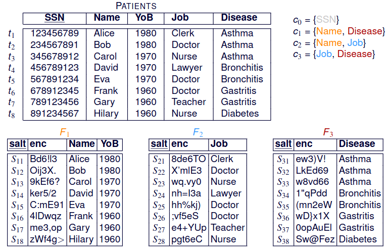

#### Ottimizzazione
L'obiettivo è avere il minor numero di frammenti, cerchiamo di avere **visibilità massima**:
- Solo gli attributi con costrain singleton sono criptati
- Tutti gli attributi non sensibili appaiono in chiaro in un frammento

Possiamo basare la frammentazione su criteri diversi:
- Numero dei frammenti
- Massima affinità
- Query workload

##### DEF - Frammentazione Minimale
$\mathscr{F}$ è **minimale** se per tutte le frammentazioni di $\mathscr{F}$ ottenute unendo due qualsiasi frammenti in $\mathscr{F}$ si viola almeno un vincolo.

##### Maximum affinity
Preferiamo tenere assieme attributi con più affinità (coinvolti spesso assieme nelle query).
Vogliamo quindi massimizzare la somma dell'affinità di tutte le coppie di attributi nel frammento), anche in questo caso NP-hard.

Utilizziamo un euristica che combina iterativamente frammenti con la massima affinità che non violano costraint, una semplice **scelta greedy**.

  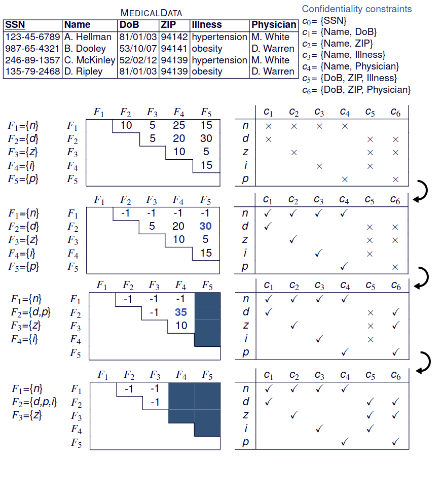

##### Query Workload
Preferiamo minimizzare il costo di esecuzione delle query, utilizziamo delle query rappresentative per avere una baseline e costruiamo un modello che basato sulla selettività delle condizioni delle query e la loro frequenza.

### Keep a few
Soluzione ibrida che conserva solo parte dei dati sul cloud.

Dati:
- $R(A_1, \dots, A_n)$: schema di relazione
- $\mathscr{C} = \{c_1, \dots, c_m\}$: vincoli di confidenzialità su $R$

Cerchiamo una frammentazione $\mathscr{F} = \langle F_o, F_s \rangle$ per $R$, dove:
- $F_o$ è memorizzato presso il proprietario
- $F_s$ è memorizzato su un server di archiviazione

Tale che garantisca :
- **Completezza**: $F_o \cup F_s = R$
- **Confidenzialità**: $\forall c \in \mathscr{C}, c \not\subseteq F_s$
- **Non-ridondanza**: $F_o \cap F_s = \emptyset$ (può essere rilassata)

A livello fisico, $F_o$ e $F_s$ hanno in comune un `tid` aggiuntivo (o un attributo chiave non sensibile) per garantire lossless join.

  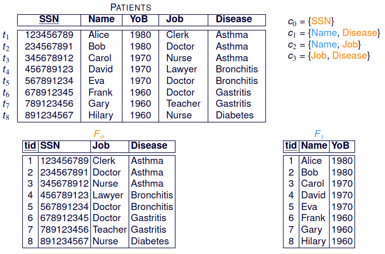

#### Query evaluation
Per costruire query per $F_o$ ed $F_s$ a partire da quelle per $R$ di tipo `SELECT` $A$ `FROM` $R$ `WHERE` $C$, dove $C$ è una congiunzione di:
- $C_o$: condizioni che coinvolgono solo attributi memorizzati presso il client
- $C_s$: condizioni che coinvolgono solo attributi memorizzati presso il server
- $C_{so}$: condizioni che coinvolgono attributi memorizzati presso il client e attributi memorizzati presso il server

Possiamo adottare due strategie:
- **Server-Client**
    - **server:** valuta $C_s$ e restituisce il risultato al client
    - **client:** riceve il risultato dal server ed esegue il join con $F_o$
    - **client:** valuta $C_o$ e $C_{so}$ sulla relazione risultante dal join

- **Client-Server**
    - **client:** valuta $C_o$ e invia al server i `tid` delle tuple nel risultato
    - **server:** esegue il join dell'input con $F_s$, valuta $C_s$ e restituisce il risultato al client
    - **client:** esegue il join del risultato ricevuto dal server con $F_o$ e valuta $C_{so}$

Se lo storage owner conosce la query (o può ricostruirla) client-server leaka informazioni: il server sa quali tuple soddisfano le condizioni di $C_0$.

#### Ottimizzazione
##### DEF- Frammentazione Minimale
L'obiettivo è minimizzare il workload del client nella gestione di $F_o$. Data una funzione di peso $w$ che restituisce il workload per una coppia $\lang F_o, F_s \rang$ una frammentazione $\mathscr{F} = \lang F_o, F_s \rang$ è **minimale** sse:
- $\mathscr{F}$ è corretta
- $\nexists \mathscr{F}'$ t.c. $w(\mathscr{F}') < w(\mathscr{F})$ and $\mathscr{F}'$ è corretta

##### Metriche
Le metriche da applicare dipendono da cosa si vuole ottimizzare e dalle informazioni disponibili:
- **Storage**:
    - **Min-Attr**: sono noti il set di attributi e i constraint di confidenzialità
        - Minimizza numero di attributi in $F_o$: $w_a(\mathscr{F})=|F_o|$ 
    - **Min-Size**: sono noti il set di attributi, le loro dimensioni e i constraint di confidenzialità
        - Minimizza la dimensione degli attributi in $F_o$: $w_s(\mathscr{F})=\sum_{A \in F} \text{size}(A)$ 

- **Computation/traffic**:

    - **Min-Query**: sono noti il set di attributi, un profilo rappresentativo del workload delle query e i constraint di confidenzialità
        - Minimizza il numero di query in cui il client deve essere coinvolto: $w_q(\mathscr{F}) = \sum_{q \in \mathscr{Q}} \text{freq}(q) \text{ t.c. } \text{Attr}(q) \cap F_o \neq \emptyset$
    - ***Min-Cond**: sono noti il set di attributi, un profilo completo del workload delle query e i constraint di confidenzialità
        - Minimizza il nnumero di condizioni all'interno delle query in cui il client deve essere coinvolto: $w_c(\mathscr{F}) = \sum_{\text{cnd} \in \text{Cond}(\mathscr{Q})} \text{freq}(\text{cnd}) \text{ t.c. } \text{cnd} \cap F_o \neq \emptyset$, dove:
            - $\text{Cond}(\mathscr{Q})$ denota l'insieme di tutte le condizioni delle query in $\mathscr{Q}$
            - $\text{freq}(\text{cnd})$ è la frequenza complessiva di $\text{cnd}$

##### Minimizzazione algoritmica
Tutti questi problemi possono essere rappresentati come un problema di **hitting set** ($F_o$ deve contere almeno un attributo per ogni constraint).

Rappresentiamo tutti i criteri con un unico modello basato su:
- **Target set**: elementi in base a cui è definito il problema di minimizzazione
- **Funzione di peso**: funzione che associa un peso ad ogni target
- **Peso di un set di attributi**: somma dei pesi dei target che hanno intersezione col set

  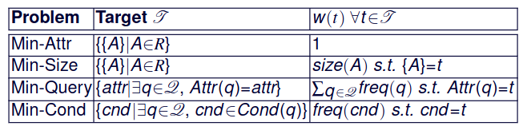

###### DEF - Weighted Minimum Target Hitting Set Problem (WMTHSP)
Dati:
- un insieme finito $A$
- un insieme $C$ di sottoinsiemi di $A$
- un insieme $\mathscr{T}$ (target) di sottoinsiemi di $A$
- una funzione peso $w: \mathscr{T} \to \mathbb{R}^+$

Cerchiamo un sottoinsieme $S$ di $A$ tale che:
1. $S$ sia un *hitting set* di $A$
2. $\nexists S'$ tale che 
    - $S'$ sia un *hitting set* di $A$
    - $\sum_{t \in \mathscr{T}, t \cap S' \neq \emptyset} w(t) < \sum_{t \in \mathscr{T}, t \cap S \neq \emptyset} w(t)$

Questo problema è NP-hard e risolto secondo un algoritmo euristico:
- **Input**
  - $\mathscr{A}$: insieme degli attributi che non compaiono nei vincoli singleton
  - $\mathscr{C}$: insieme dei vincoli ben definiti
  - $\mathscr{T}$: insieme dei target
  - $w$: funzione peso definita su $\mathscr{T}$

- **Output**
  - $\mathscr{H}$: insieme degli attributi che compongono $F_o$, insieme a quelli che compaiono nei vincoli singleton
  - $F_s$ viene calcolato come $R \setminus F_o$, ottenendo una frammentazione corretta

- **Rappresentazione**
    - **Priority-queue** $PQ$ con un elemento $E$ per ogni attributo:
      - $E.A$: attributo
      - $E.C$: puntatori ai vincoli non soddisfatti che contengono $E.A$
      - $E.T$: puntatori ai target che non intersecano $\mathscr{H}$ e che contengono $E.A$
      - $E.n_c$: numero di vincoli puntati da $E.C$
      - $E.w$: peso totale dei target puntati da $E.T$

    - La priorità è dettata da $E.w / E.n_c$: gli elementi con rapporto inferiore hanno priorità maggiore

- **Esecuzione**
    - **while** $PQ \neq \emptyset$ e $\exists E \in PQ, E.n_c \neq 0$
      - estrai l'elemento $E$ con il valore minimo di $E.w / E.n_c$ da $PQ$
      - inserisci $E.A$ in $\mathscr{H}$
      - $\forall c$ puntato da $E.C$, rimuovi i puntatori a $c$ da qualsiasi elemento $E'$ in $PQ$ e aggiorna $E'.n_c$
      - $\forall t$ puntato da $E.T$, rimuovi i puntatori a $t$ da qualsiasi elemento $E'$ in $PQ$ e aggiorna $E'.w$
      - riordina $PQ$ in base ai nuovi valori di $E.w / E.n_c$ (*to_be_updated*)

    - **for** ogni $A \in \mathscr{H}$
      - se $\mathscr{H} \setminus \{A\}$ è un *hitting set* per $\mathscr{C}$, rimuovi $A$ da $\mathscr{H}$

## Pubblicazione di Associazioni Offuscate
Nel data publishing può essere necessario rilasciare dati in cui le **associazioni** tra entità sono sensibili, pur consentendo ad un set di query di essere eseguite con accuratezza. 
Due soluzioni:
- **Safe grouping**: rappresenta le associazioni come grafo bipartito e maschera la corrispondenza entità-nodo preservando la struttura del grafo
- **Fragments and loose associations**: usa fragmentation per rispettare constraint di confidenzialità e requisiti di visibilità, pubblicando in più le associazioni in forma sanitizzata

### Anonimizzazione di grafi bipartiti (Safe Grouping)
Lo scenario è composto da:
- `Customer(Customer, State)` e `Product(Product, Avail)` (es. `Rx` / `OTC`): informazioni pubbliche
- `Purchase(Customer, Product)`: l'associazione sensibile, modellata come **grafo bipartito** $G = (V, W, E)$ con $V$ clienti, $W$ prodotti ed $E$ archi di acquisto

L'obiettivo è pubblicare una versione anonimizzata del grafo tale che:
- Una vasta classe di query abbia risposte accurate:
    - **Tipo 0**: predicato sulla struttura del grafo (es. numero medio di prodotti acquistati per cliente)
    - **Tipo 1**: predicato sugli attributi di un solo lato (es. numero medio di prodotti acquistati dai clienti del NJ)
    - **Tipo 2**: predicato sugli attributi di entrambi i lati (es. numero medio di prodotti OTC acquistati dai clienti del NJ)
- La privacy delle singole associazioni sia preservata

#### $(k,l)$-grouping
L'idea di base è preservare la struttura del grafo ma permutare la mappatura entità → nodo

Un $(k,l)$-grouping di $G = (V, W, E)$:
- Partiziona $V$ ($W$) in sottoinsiemi disgiunti di dimensione $\ge k$ ($\ge l$)
- Pubblica un set di archi $E'$ **isomorfo** a $E$, in cui la mappatura da $E$ a $E'$ è anonimizzata sulla base delle partizioni di $V$ e $W$

Concretamente si pubblicano:
- $E'$: gli archi tra i nodi anonimi (es. $x_i$ per i clienti, $y_j$ per i prodotti)
- $H_V$, $H_W$: la relazione che associa ogni entità al **suo gruppo** (es. $c_1 \to CG_1$)
- $R_V$, $R_W$: la relazione che associa ogni nodo anonimo al **suo gruppo** (es. $x_1 \to CG_1$)

  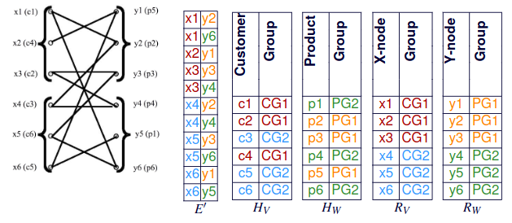

Un attaccante sa quindi che $c_1$ è in $CG_1$ e che i nodi di $CG_1$ sono $x_1, x_2, x_3$, ma non sa quale dei tre sia $c_1$. L'arco $(x_i, y_j)$ può corrispondere a qualsiasi coppia (cliente del gruppo, prodotto del gruppo).

#### Safe grouping
Non tutti i $(k,l)$-grouping offrono lo stesso livello di privacy, un grouping è **safe** se:
- Nodi dello stesso gruppo di $V$ **non sono connessi ad uno stesso nodo** di $W$ (e viceversa)

Dal punto di vista computazionale il calcolo di un safe grouping può essere difficile anche per $k$ ed $l$ piccoli: il calcolo di un safe, strict $(3,3)$-grouping è **NP-hard** (riduzione da *partitioning a graph into triangles*). Sono presenti algoritmi euristici abbastanza accurati.

### Fragments e Loose Associations
Usiamo fragmentation nel contesto del **data publishing**: si rilasciano a terze parti solo viste (frammenti) che non espongono associazioni sensibili. 

Per aumentare l'utilità i frammenti possono essere accompagnati da **loose association**: associazioni tra *gruppi* di valori invece che tra valori specifici.

#### Constraint e requisiti
##### Confidentiality constraint
Insiemi di attributi la cui visibilità congiunta deve essere protetta (già visti nella parte su fragmentation + encryption):

##### Visibility requirement
Formule booleane **monotone** sugli attributi che rappresentano viste sui dati (le negazioni sono già catturate dai constraint). Permettono di esprimere:
- **Attributi visibili**
- **Associazioni visibili**
- **Viste alternative**: almeno una tra le viste specificate deve essere visibile

###### ES

  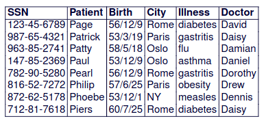

- $v_1 = Patient \lor City$: devono essere rilasciati i nomi dei pazienti oppure le città
- $v_2 = (Birth \land City) \lor SSN$: devono essere rilasciate le coppie data di nascita-città in associazione, oppure gli SSN
- $v_3 = Illness \land Doctor$: devono essere rilasciati malattie e dottori, ed anche la loro associazione

#### Fragmentation
Si rilasciano solo frammenti che:
- Non includono attributi o associazioni sensibili
- Includono gli attributi e/o le associazioni richiesti (i requisiti devono essere soddisfatti, ma **non necessariamente da un singolo frammento**)

###### ES

  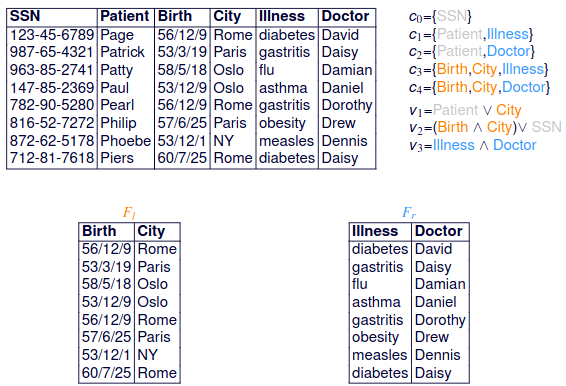

##### Frammentazione corretta e minimale
Una frammentazione è **corretta** se:
- Ogni constraint è soddisfatto da tutti i frammenti
- Ogni visibility requirement è soddisfatto da almeno un frammento
- I frammenti **non hanno attributi in comune** (altrimenti un join sui frammenti permetterebbe di ricostruire le associazioni)

Una frammentazione corretta è **minimale** se il numero di frammenti è minimo (ogni altra frammentazione corretta ha un numero di frammenti uguale o superiore).

Il problema **Min-CF** (calcolo di una frammentazione corretta e minimale) è **NP-hard**, ma può essere risolto efficientemente con un **SAT solver**.

#### Loose associations
La frammentazione rompe le associazioni tra attributi. Per aumentare l'utilità dei dati pubblicati accoppiamo ai frammenti alcune associazioni in forma sanitizzata, garantendo un certo **grado di privacy** dell'associazione.

Date due istanze $f_l$ ed $f_r$ di $F_l$ ed $F_r$, una loose association:
- Partiziona le tuple dei frammenti in **gruppi**
- Fornisce informazione sulle associazioni a livello di gruppo
- Non permette di ricostruire esattamente le associazioni originali tra le tuple

#### Grouping
Dato un frammento $F_i$ e una sua istanza $f_i$, un **$k$-grouping** su $f_i$ partiziona le tuple di $f_i$ in gruppi di dimensione $\ge k$: ogni tupla $t$ è associata ad un group identifier $G_i(t)$.
- Un $k$-grouping è **minimale** se massimizza il numero di gruppi (intuitivamente minimizza la dimensione dei gruppi)
- Un **$(k_l, k_r)$-grouping** è una coppia di grouping su $f_l$ ed $f_r$, ed è minimale se lo sono entrambi

###### ES

  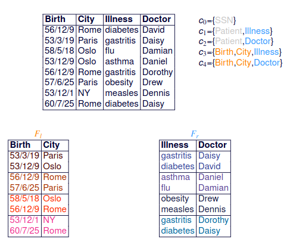

#### Group association
Un $(k_l, k_r)$-grouping induce una **group association** $\mathcal{A}$ tra i gruppi di $f_l$ ed $f_r$: un insieme di coppie di group identifier tale che:
- $\mathcal{A}$ ha la stessa cardinalità della relazione originale
- Esiste una **mappa biiettiva** tra la relazione originale e $\mathcal{A}$ che associa ogni tupla originale alla coppia $(G_l(l), G_r(r))$ con $l \in f_l$, $r \in f_r$

###### ES

  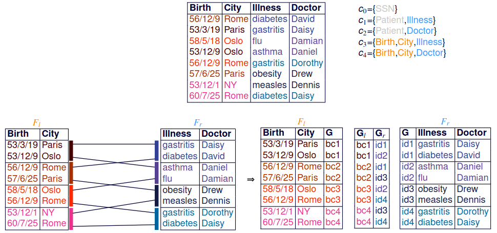

##### Protezione della group associan
I **duplicati** nei frammenti vengono mantenuti (tutti i frammenti hanno la cardinalità della relazione originale).

Ma anche tuple diverse possono avere gli stessi valori per gli attributi coinvolti in un constraint: la protezione offerta dal grouping può essere compromessa se non controlliamo le occorrenze degli stessi valori.

##### Alikeness
Due tuple $l_i, l_j \in f_l$ (risp. $r_i, r_j \in f_r$) sono **alike** rispetto ad un constraint $c$, $l_i \simeq_c l_j$, se:
- $c \subseteq (F_l \cup F_r)$ ($c$ è coperto da $F_l$ ed $F_r$)
- $l_i[c \cap F_l] = l_j[c \cap F_l]$ (risp. $r_i[c \cap F_r] = r_j[c \cap F_r]$)

Due tuple sono alike ($l_i \simeq l_j$) se lo sono rispetto ad **almeno un** constraint coperto da $F_l$ ed $F_r$.
- $\simeq_c$ è transitiva per ogni constraint $c$
- $\simeq$ **non** è transitiva se ci sono almeno due constraint coperti da $F_l$ ed $F_r$

###### ES

  

- Le tuple a sinistra con $(56/12/9, Rome)$ sono alike rispetto a $c_3$ e $c_4$ (stessi valori su $Birth, City$)
- A destra le due tuple con $gastritis$ sono alike rispetto a $c_3$ (stessa malattia), le due con $diabetes$ lo sono rispetto a $c_3$, le due con $Daisy$ rispetto a $c_4$ (stesso dottore)
- La tupla $(gastritis, Daisy)$ è alike sia a $(gastritis, Dorothy)$ ($c_3$) sia a $(diabetes, Daisy)$ ($c_4$), ma queste ultime due **non** sono alike tra loro: la relazione non è transitiva

#### $k$-loose association
Una group association è **$k$-loose** se ogni tupla di $\mathcal{A}$ corrisponde in modo indistinguibile ad almeno $k$ associazioni distinte tra le tuple dei frammenti.
- Una $k$-loose association è anche $k'$-loose per ogni $k' \le k$
- Un $(k_l, k_r)$-grouping induce una group association **minimale** se 
    - $\mathcal{A}$ è $k$-loose
    - $\nexists (k_l', k_r')$-grouping che induce una $k$-loose association con $k_l' \cdot k_r' < k_l \cdot k_r$

  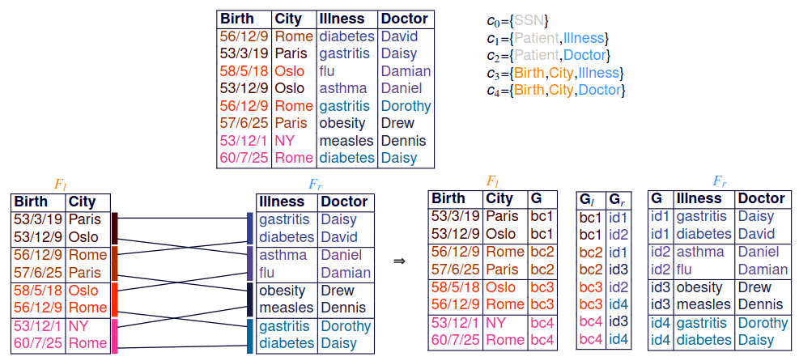

##### Proprietà di eterogeneità
C'è una corrispondenza tra $k_l, k_r$ e il grado di looseness:
- Un $(k_l, k_r)$-grouping **non può** indurre una association $k$-loose per $k > k_l \cdot k_r$
- Il valore effettivo $k \le k_l \cdot k_r$ dipende da come sono definiti i gruppi
- Se il grouping soddisfa le seguenti proprietà di eterogeneità la group association indotta è $k$-loose con $k = k_l \cdot k_r$:

**Group heterogeneity**
- Nessun gruppo può contenere tuple alike rispetto ai constraint coperti da $F_l$ ed $F_r$
- Garantisce diversità all'interno dei gruppi

**Association heterogeneity**
- Nessun gruppo può essere associato due volte ad un altro gruppo (la group association non può contenere duplicati)
- Garantisce che per ogni tupla reale ci siano almeno $k_l \cdot k_r$ coppie in $\mathcal{A}$ a cui può corrispondere

**Deep heterogeneity**
- Nessun gruppo può essere associato a due gruppi che contengono tuple alike
- Garantisce che le $k_l \cdot k_r$ coppie a cui ogni tupla può corrispondere contengano valori diversi per gli attributi coinvolti nei constraint

##### Flat grouping vs sparse grouping
Un $(k_l, k_r)$-grouping è:
- **Flat** se $k_l = 1$ oppure $k_r = 1$
- **Sparse** se entrambi sono diversi da 1

Confronto:
- Flat grouping ricorda **$k$-anonymity** e cattura allo stesso tempo la proprietà di **$\ell$-diversity**, ma lavora sulle associazioni e **senza generalizzare** i valori degli attributi
- Sparse grouping ha applicabilità maggiore a parità di protezione (può esistere un sparse grouping che garantisce $k$-looseness quando non esiste un flat grouping)

### Privacy vs Utility
Pubblicare loose association aumenta l'utilità (le query possono essere valutate con più precisione rispetto ai soli frammenti) ma **aumenta l'esposizione** (riduce la privacy).

L'esposizione di un'associazione sensibile $\langle l[c \cap F_l], r[c \cap F_r] \rangle$ (con $c$ coperto da $F_l, F_r$) è la **probabilità che l'associazione sia presente nella relazione originale** date le informazioni pubblicate.

L'incremento di esposizione dovuto alle loose association è la differenza tra:
- $P_\mathcal{A}(l[c \cap F_l], r[c \cap F_r])$: probabilità dati $f_l$, $f_r$ **e $\mathcal{A}$**
- $P(l[c \cap F_l], r[c \cap F_r])$: probabilità dati solo $f_l$ ed $f_r$

#### Esposizione senza loose association
Date $l \in f_l$ ed $r \in f_r$ la probabilità che la coppia appartenga alla relazione originale è:
$$P(l, r) = \frac{1}{|f_l|} = \frac{1}{|f_r|}$$

L'esposizione di $\langle l[c \cap F_l], r[c \cap F_r] \rangle$ dipende dalla presenza di **tuple alike**, se $l_i \simeq_c l_j$ la probabilità è la **composizione** delle probabilità che $l_i$ sia associata ad $r$ e che $l_j$ sia associata ad $r$: 
$$P(l_i, r) + P(l_j, r) - P(l_i, r) \cdot P(l_j, r)$$

###### ES

  

Con 8 tuple ogni coppia ha probabilità $1/8$. Le due tuple $(56/12/9, Rome)$ sono alike rispetto a $c_3$, quindi:
- Sulla riga $(56/12/9, Rome)$: $\frac{1}{8} + \frac{1}{8} - \frac{1}{8}\cdot\frac{1}{8} = \frac{15}{64}$ (le due righe si fondono in una sola)
- Ora la colonna: $gastritis$ (appare due volte, con $Daisy$ e $Dorothy$) si compone allo stesso modo con sé stessa. Nella cella $(56/12/9, Rome, gastritis)$: $\frac{15}{64} + \frac{15}{64} - \left(\frac{15}{64}\right)^2 = \frac{1695}{4096}$
- Stesso valore per $diabetes$ (appare due volte con $David$ e $Daisy$)
- Righe non fuse e colonne non duplicate: $1/8$; righe non fuse con $gastritis/diabetes$: $15/64$; riga $(56/12/9, Rome)$ con le altre malattie: $15/64$

----

#### Esposizione con loose association
Date $l \in f_l$ ed $r \in f_r$ la probabilità $P_\mathcal{A}(l, r)$ che la coppia appartenga alla relazione originale è **al più $1/k$**. Si valuta ancora considerando la relazione $\simeq_c$:
$$P_\mathcal{A}(l_i, r) + P_\mathcal{A}(l_j, r) - P_\mathcal{A}(l_i, r) \cdot P_\mathcal{A}(l_j, r)$$

###### ES

Con un $(2,2)$-grouping (4-loose) ogni tupla è compatibile con $4$ coppie, quindi le celle compatibili valgono $1/4$ e le altre $0$.
- Le due tuple $(56/12/9, Rome)$ stanno in gruppi diversi ($bc_2$ e $bc_3$) e quindi sono compatibili con insiemi di tuple a destra differenti
- $gastritis$: compare nel gruppo associato a $bc_2$ (con $Daisy$) e in quello associato a $bc_3$ (con $Dorothy$): $\frac{1}{4} + \frac{1}{4} - \frac{1}{4}\cdot\frac{1}{4} = \frac{7}{16}$
- Stesso per $diabetes$; tutte le altre celle della riga: $1/4$

#### Misurare utilità e privacy
- **Utilità**: media della variazione di probabilità $\lvert P_\mathcal{A}(l[c \cap F_l], r[c \cap F_r]) - P(l[c \cap F_l], r[c \cap F_r]) \rvert$ su tutte le associazioni sensibili. Può essere misurata anche in termini di **precisione nelle risposte alle query**
- **Privacy**: oltre al grado di looseness $k$ si può specificare una **soglia di esposizione** $\delta_{max}$: $\mathcal{A}$ può essere pubblicata se
$$\delta_{max} \ge P_\mathcal{A}(l[c \cap F_l], r[c \cap F_r]) - P(l[c \cap F_l], r[c \cap F_r])$$
per tutte le associazioni sensibili

###### ES
Nell'esempio le differenze $P_\mathcal{A} - P$ sono:
- $\pm 1/8$ per le celle in cui i gruppi rendono la coppia compatibile / incompatibile
- $1/64$ per le celle non fuse con $gastritis$/$diabetes$ (da $15/64$ a $1/4$)
- $97/4096$ per $(56/12/9, Rome, gastritis/diabetes)$ (da $1695/4096$ a $7/16 = 1792/4096$)

Mediando sulle $7 \times 6 = 42$ celle:
$$\text{Utility} = \frac{\sum_{l,r} \lvert P_\mathcal{A}(l[Birth, City], r[Illness]) - P(l[Birth, City], r[Illness]) \rvert}{42} = \frac{13506}{172032}$$

