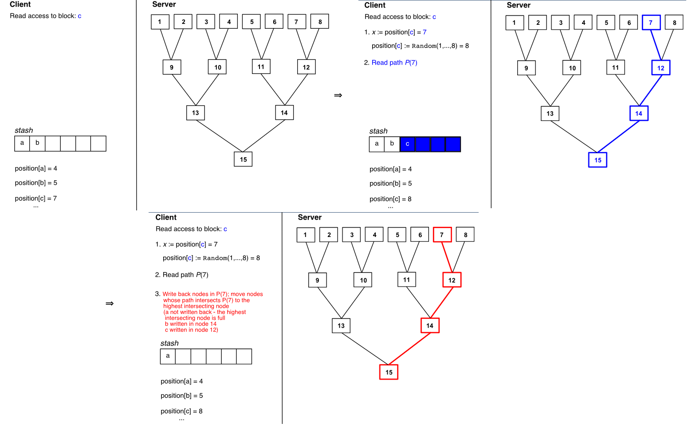
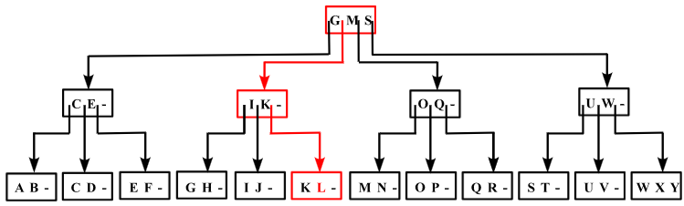
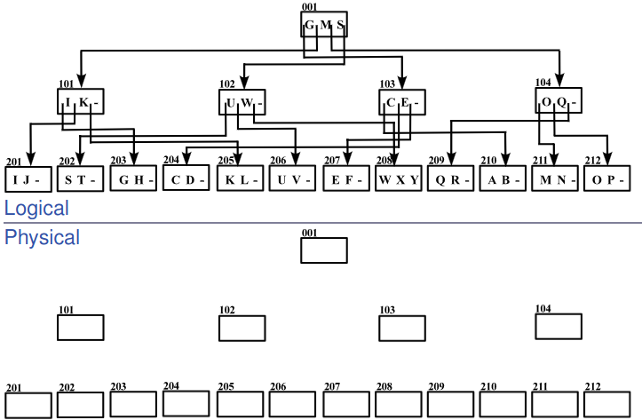
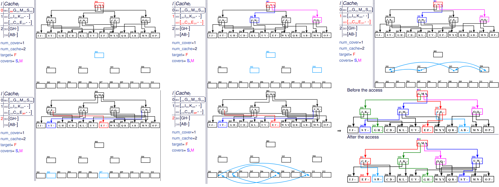

# Privacy per Accessi

Per garantire la privacy per gli accessi a dati outsourced bisogna tutelare:
- Confidenzialità degli accessi
- Confidenzialità dei pattern di accesso

## Path ORAM
- **Lato Server**
    - Albero binario con $L=log_2 N - 1$ livelli, con $N$ numero di blocchi
    - Ogni nodo è un bucket contenente fino a $Z$ blocchi reali (con blocchi dummy per padding)
    - Ogni foglia ha $x$ un cammino unico $P(x)$

- **Lato Client**
    - Il client conserva localmente:
        - Un piccolo numero di blocchi in uno **stash**
        - Una mappa per $x=\text{pos}(a)$: il blocco $a$ (se esiste) risiede in un blocco nella path $P(x)$ o nello stash
    - La mappa cambia ogni volta ch si effettua un accesso ed i blocchi vengono rimappati

#### Main invariant
In ogni momento deve rispettare **main invariant**:
- Ogni blocco è mappato al bucket di una foglia in maniera casuale
- I blocchi non in stash sono in un bucket sulla path per la foglia mappata

##### Esecuzione di operazioni di R/W
1. **Remap block**: Rimappa il nodo $a$ dalla vecchia posizione $x$ ad una nuova posizione casuale (un nuovo nodo foglia)
2. **Read path**: Scarica i nodi in $P(x)$ che contengono $a$. Se l'accesso è una write aggiorna i dati del blocco $a$
3. **Write path**: Riscrivi i nodi in $P(x)$, includendo blocchi dello stash se possono essere piazzati nella path se possibile

###### ES

  

## Ring ORAM
Variante di path ORAM che riduce la larghezza di banda per gli accessi.
- Mantiene la stessa struttra server-client
- Ogni nodo ha:
    - $S$ dummy block
    - Una mappa per l'offset dei propri blocchi
    - Un counter degli accessi

##### Esecuzione di operazioni di R/W
1. **Remap**: uguale ad ORAM
2. **Read path**: rivisto per scaricare solo un blocco per bucket
3. **Write path**: fattorizzato tra più operazioni di accesso (eviction phase)

## Shuffle Index
Alternativa a ORAM basata su un B+-tree, che sfrutta tre meccanismi combinati: **cover search**, **cached search** e **shuffling**.

### Struttura dati
- I dati sono indicizzati su una candidate key $K$ e organizzati come **B+-tree non concatenato** (*unchained*, le foglie non sono collegate tra loro) con fan out $F$
- I dati sono memorizzati nelle foglie in associazione al valore dell'index
- Gli accessi  si basano sul valore dell'index
- Struttura di un nodo:
    - $q \ge \lceil F/2 \rceil$ figli con $q - 1$ valori $v_1 \le \dots \le v_{q-1}$
    - L'$i$-esimo figlio è radice di un sottoalbero contenente i valori $v$ con $v < v_1$, $v_{i-1} \le v < v_i$, oppure $v \ge v_{q-1}$

###### ES

  

- A livello **logico** i puntatori tra nodi diventano **node identifier**: la struttura è un insieme di coppie $\langle id, n \rangle$ con $id$ identificatore e $n$ contenuto del nodo. L'ordine tra gli identificatori **non corrisponde** necessariamente all'ordine in cui i nodi compaiono nella rappresentazione abstract
- A livello **fisico** ogni nodo $\langle id, n \rangle$ è memorizzato sul server **cifrato** come blocco $\langle id, b \rangle$ con:
    - $b = \mathscr{C} \| \mathscr{T}$:
    - $\mathscr{C} = E_k(s \| n)$ con $s$ valore scelto a caso ad ogni cifratura (**salt**)
    - $\mathscr{T} = \text{MAC}_{k'}(id \| \mathscr{C})$ (garantisce l'integrità e lega il contenuto all'identificatore)

  

#### Accesso ai dati
Processo iterativo tra client e server:
- Il client esegue un'iterazione per ogni livello dell'indice, partendo dalla radice
- Ad ogni iterazione il client:
    - Decifra il blocco ricevuto
    - Determina il blocco da richiedere al server al livello successivo
- Il processo termina quando viene recuperato un blocco foglia

#### Conoscenza dell'osservatore (server)
- Il server riceve un insieme di blocchi da memorizzare
- Le richieste di accesso si traducono in **osservazioni**: un'osservazione $o_i$ è una sequenza di blocchi $\{b_{i1}, \dots, b_{ih}\}$
- Il server conosce o può facilmente inferire:
    - Il numero $m$ di blocchi e i loro identificatori
    - L'altezza $h$ dello shuffle index
    - Il livello associato ad ogni blocco (dopo aver osservato una lunga storia di accessi)

Data una sequenza di osservazioni $\{o_1, \dots, o_z\}$ il server non deve poter inferire:
- I dati memorizzati nell'index (**content confidentiality**)
- Il dato a cui è diretta una richiesta: $\forall i$ non deve inferire che $o_i$ sia diretta ad uno specifico nodo (**access confidentiality**)
- Che $o_i$ acceda allo stesso nodo di $o_j$, $\forall i \ne j$ (**pattern confidentiality**)

Bisogna quindi distruggere la corrispondenza tra le frequenze con cui i blocchi vengono acceduti e le frequenze di accesso ai diversi valori, combinando tre strategie:
- **Cover search**: confusione sui singoli accessi
- **Cached search**: protezione degli accessi ripetuti agli stessi valori
- **Shuffling**: cambia dinamicamente l'allocazione dei nodi nei blocchi ad ogni accesso, distruggendo la corrispondenza fissa nodo-blocco

### Cover search
Si introduce confusione sul target di un accesso nascondendolo in un gruppo di altre richieste che fanno da **cover**.
- Il numero di cover (**num_cover**) è un parametro di protezione
- Le cover search devono:
    - Fornire **block diversity**: stare su un path disgiunto da quello del target (tranne la radice)
    - Essere **indistinguibili** dalle ricerche reali (frequenza di accesso plausibile)

Protezione offerta:
- Le foglie osservate hanno la stessa probabilità di contenere il target 
- La relazione padre-figlio tra i blocchi acceduti è confusa 
- La relazione padre-figlio può essere rivelata da **intersection attack**: se due richieste sono dirette allo stesso target, **il blocco target compare in entrambe le osservazioni** mentre le cover cambiano.

### Cached search
Il client mantiene una **cache locale** dei nodi lungo il path verso il target per contrastare gli intersection attack:
- Inizializzata con **num_cache** path disgiunti e gestita con politica Least Recently Used
- **Path continuity**: se un nodo è in cache lo è anche suo padre
- Ad ogni accesso viene aggiornata la cache
- Se il nodo target è in cache vengono eseguite **solo cover search** (num_cover + 1 cover)
    - Fornisce osservazioni false al server
    - Permette (insieme allo shuffling) di rinfrescare la cache

Protezione offerta:
- La cache contrasta gli intersection attack **a breve termine**: non protegge dagli attacchi su osservazioni oltre la dimensione della cache
- Con una lunga storia di osservazioni il server può ricostruire la **topologia** (relazioni padre-figlio) dello shuffle index

### Shuffling
Spezza la corrispondenza uno-a-uno blocchi-nodi **scambiando il contenuto dei nodi** (e quindi dei blocchi).
- Richiede decifratura e ricifratura dei nodi: il testo cifrato di un nodo cambia ad ogni accesso (cambiano identificatore e salt)
- Vengono scambiati i contenuti di **tutti i blocchi letti** nell'accesso e dei **nodi in cache**
- I blocchi shufflati vengono riscritti sul server
- Lo shuffling dei nodi di un livello richiede di **aggiornare i puntatori dei loro padri**

### Combinazione delle tecniche
#### Esecuzione di un accesso e gestione dello shuffle index
Sia $v$ il valore target. Si determinano $\text{num\_cover} + 1$ valori di cover e, **per ogni livello $l$** dello shuffle index:
1. Si determinano gli identificatori (**ToRead_ids**) dei blocchi nel path verso $v$ e verso le cover
2. Se il nodo nel path verso $v$ **non è** in $Cache_l$ (*cache miss*) si eseguono solo **num_cover** cover search (più il target reale); se è in cache si usano tutte le $\text{num\_cover}+1$ cover. In entrambi i casi il numero di blocchi richiesti per livello non cambia
3. Si richiedono al server i blocchi con identificatore in ToRead_ids e se ne decifra il contenuto (insieme **Read**)
4. Si fa lo **shuffle** dei nodi in Read e in $Cache_l$ secondo una permutazione $\pi$
5. Si aggiornano i **puntatori dei padri** dei nodi shufflati
6. Si aggiorna $Cache_l$ inserendo il nodo più recentemente acceduto nel path verso $v$ (solo in caso di cache miss)

  

#### Analisi della protezione
- **Degradazione dovuta allo shuffling**: lo shuffling degrada qualsiasi informazione che il server possa avere sulla corrispondenza nodi-blocchi
- **Access confidentiality**: ad ogni accesso l'informazione sullo specifico accesso è divisa tra $\text{num\_cover} + 1$ nodi, e lo shuffling distrugge la corrispondenza nodi-blocchi
- **Pattern confidentiality**: accessi separati da un numero significativo di passi non sono riconoscibili (grazie allo shuffling)
    - Protezione di **breve termine**: cover e cache
    - Protezione di **lungo termine**: cover e shuffling
