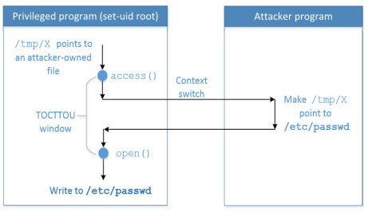
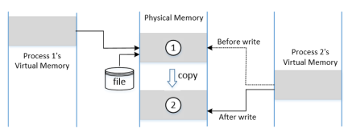
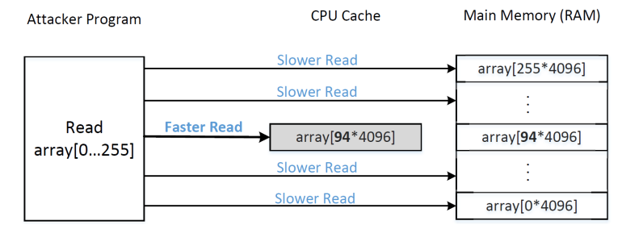
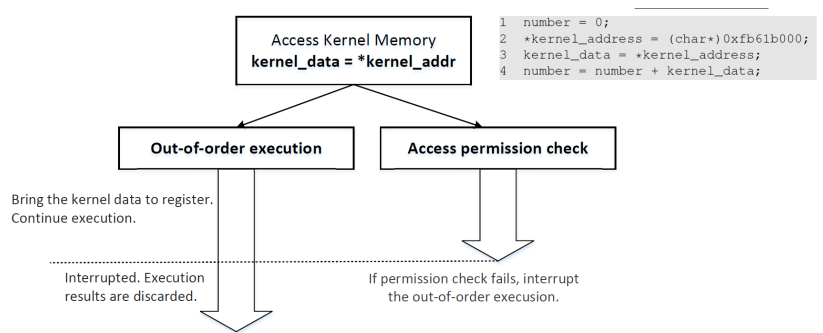

# Parte 1
Una **Race Condition** si verifica quando più processi o thread accedono e manipolano dati condivisi in modo concorrente, e l'esito dell'esecuzione dipende dall'ordine temporale (imprevedibile) degli eventi. Se un programma privilegiato è affetto da questa vulnerabilità, un attaccante può manipolare l'output o il comportamento del sistema.

## 1. TOCTTOU

### Meccanica dell'Attacco TOCTTOU

* Il programma privilegiato (es. Set-UID root) verifica le autorizzazioni di un file tramite la funzione di sistema `access()`, basata sull'ID utente reale.
* Successivamente, il programma apre il file tramite `open()`, che utilizza l'ID utente effettivo (in questo caso, root).
* L'attaccante sfrutta la finestra temporale che intercorre tra il "Check" (`access`) e lo "Use" (`open`).
* Durante questa minuscola finestra, l'attaccante sostituisce il file con un symlink che punta a un file critico di sistema 


<p align="center">
  
</p>

### Contromisure per Race Condition

* **Operazioni Atomiche:** Utilizzare flag specifici come `O_CREAT | O_EXCL` in fase di apertura, che garantiscono la creazione del file solo se questo non esiste, unendo check e use in una singola operazione.
* **Controllo Ripetuto:** Verificare la corrispondenza degli inode tramite `fstat()` prima e dopo l'apertura del file, abbassando drasticamente le probabilità statistiche di successo dell'attacco.
* **Protezione Symlink (Sticky Symlinks):** Configurare il kernel (`fs.protected_symlinks=1`) per impedire di seguire collegamenti simbolici in directory scrivibili da tutti (come `/tmp`) a meno che il proprietario del symlink non corrisponda al proprietario della directory o del processo.
* **Principio del Minimo Privilegio:** Usare `seteuid()` per declassare temporaneamente i privilegi di root a quelli dell'utente reale prima di eseguire operazioni su file non fidati.


## 2. Dirty COW (Copy-On-Write)

Dirty COW è una complessa vulnerabilità di Race Condition annidata nei meccanismi di gestione della memoria del kernel Linux, specifica per la funzionalità Copy-On-Write (COW).

`mmap()`, usata per mappare i file nella memoria virtuale del processo, ha due modalità:
* `MAP_SHARED` crea una memoria condivisa effettiva tra processi.
* `MAP_PRIVATE` mappa il file in una memoria privata. Qualsiasi tentativo di scrittura non modificherà il file originale sul disco, ma innescherà il meccanismo Copy-On-Write.

Il processo di Copy-On-Write si compone di tre fasi non atomiche:

<p align="center">
  
</p>

1. Viene creata una copia privata della memoria mappata.
2. La page table viene aggiornata affinché la memoria virtuale del processo punti alla nuova pagina fisica privata.
3. Il dato viene scritto nella nuova pagina.

### Meccanica dell'Attacco Dirty COW
L'attaccante sfrutta la funzione `madvise()` con il parametro `MADV_DONTNEED`, che impone al kernel di scartare la pagina di memoria appena copiata.

L'attaccante lancia due thread concorrenti 
- Uno esegue ripetutamente scritture (tramite il filesystem `/proc/self/mem`) 
- Uno chiama incessantemente `madvise()`

Se `madvise()` viene eseguito esattamente tra il passo 2 e il passo 3 del COW, la tabella delle pagine viene ripristinata per puntare alla memoria fisica originale (di sola lettura). 
La successiva operazione di scrittura modificherà permanentemente il file originale aggirando i permessi di sicurezza.


## 3. Meltdown e Spectre - Componenti tecniche

Sia Meltdown che Spectre non derivano da bug del software, ma sfruttano il funzionamento intrinseco e le ottimizzazioni di performance dei processori moderni.

### Fondamenti Architetturali

* **Out-of-Order Execution:** La CPU esegue le istruzioni non appena le risorse e gli operandi sono disponibili, anticipando il lavoro invece di attendere passivamente. I risultati vengono poi "ritirati" (committed) nel corretto ordine logico.
* **Speculative Execution:** Di fronte a un salto condizionale (es. un `if`), la CPU "indovina" quale sarà la strada più probabile da prendere e inizia a eseguirla in anticipo. Se l'ipotesi è errata, i risultati architettonici vengono scartati e lo stato dei registri ripristinato.
* **Caching:** I dati portati in cache durante un'esecuzione speculativa errata **non** vengono scartati quando lo stato della CPU viene ripristinato.

## 4. L'Attacco Meltdown (Rogue Data Cache Load)

Meltdown rompe il confine di isolamento tra lo user space e il kernel space. Sfrutta una debolezza specifica nella gestione delle eccezioni e dei controlli dei privilegi durante la Out-of-Order Execution, presente in particolar modo nelle architetture Intel.

### 4.1 Meccanica di Meltdown
Il problema fondamentale risiede nel disaccoppiamento temporale tra l'esecuzione di un'istruzione di fetch della memoria e la validazione dei privilegi da parte della Memory Management Unit (MMU).
* Quando un'istruzione a livello utente tenta di leggere un indirizzo protetto appartenente al kernel, il controllo fallisce e viene generata un'eccezione (es. un Page Fault `#PF`).
* Tuttavia, per motivi di latenza, la CPU non attende che l'eccezione venga processata e ritirata (retired) dal ROB prima di forwardare il dato letto dalla memoria (o dalla cache) alle uOps dipendenti successive.
* Si crea così una **transient execution window**: le istruzioni successive usano il dato segreto letto illegittimamente. L'attaccante utilizza questo dato come offset per moltiplicare (es. `* 4096` per evitare il prefetching) e indicizzare un "probe array" nello user space.
* Quando l'eccezione viene finalmente sollevata e la pipeline svuotata, il probe array ha già caricato una specifica cache line. Usando tecniche come **Flush+Reload**, l'attaccante misura i tempi di accesso per individuare quale pagina è in cache, de-offuscando il byte del kernel.

<p align="center">
  
</p>

### 4.2 Mitigazioni per Meltdown
* **KPTI (Kernel Page-Table Isolation):** Mitigazione software (originariamente KAISER) che separa completamente le page table dello user space da quelle del kernel space. Quando il codice è in user space, la memoria del kernel non è letteralmente mappata (salvo pochissime eccezioni come i gestori di interrupt), bloccando alla radice l'accesso speculativo. Questo introduce un forte overhead a causa dei necessari flush del TLB a ogni context switch, in parte mitigati dall'uso dei **PCID (Process-Context Identifiers)**.


## 5. Spectre

A differenza di Meltdown, Spectre non viola i confini hardware dei privilegi per leggere la memoria del kernel, ma sfrutta la manipolazione del Branch Predictor per indurre il processo vittima (es. un interprete JavaScript nel browser o un altro processo) a eseguire codice speculativo che rivela i suoi stessi dati segreti.

<p align="center">
  
</p>

### 5.1 Variante 1: Bounds Check Bypass (CVE-2017-5753)
Questa variante sfrutta l'addestramento malevolo del predittore dei salti condizionali (Pattern History Table - PHT).
* **Il vettore:** Un classico controllo di sicurezza, come `if (x < array1_size) { y = array2[array1[x] * 4096]; }`.
* **Mistraining:** L'attaccante passa valori di `x` legittimi molteplici volte. Il Branch Predictor impara che il salto condizionale sarà presumibilmente sempre valutato come *True*.
* **L'Exploit:** L'attaccante passa un valore di `x` fuori limite (out-of-bounds), calcolato affinché `array1[x]` punti a un dato segreto all'interno della memoria della vittima. La CPU, speculando, ignora il bounds check, carica il byte segreto e lo utilizza come indice per l'operazione su `array2`. Quando la speculazione viene abortita, la cache L1d conserva la traccia della lettura di `array2`, esfiltrabile tramite side channel.
* **Mitigazioni:** Mascheramento degli indici (es. clamp/AND logico sull'indice) o l'utilizzo di barriere di serializzazione (es. l'istruzione `lfence` su architetture x86 o `csdb` su ARM) poste subito dopo i salti condizionali critici per impedire la speculazione.

### 5.2 Variante 2: Branch Target Injection (CVE-2017-5715)
Questa variante avvelena la predizione dei salti indiretti (es. chiamate a puntatori a funzione o metodi virtuali) manipolando il **Branch Target Buffer (BTB)**.
* Poiché il BTB mappa gli indirizzi sorgente alle probabili destinazioni utilizzando spesso solo una parte dei bit dell'indirizzo virtuale, è possibile creare aliasing (collisioni) tra processi diversi.
* **L'Exploit:** L'attaccante esegue salti indiretti nel proprio spazio di indirizzamento progettati per "inquinare" il BTB. Quando il processo vittima esegue un normale salto indiretto, il BTB suggerisce speculativamente di saltare a un indirizzo scelto dall'attaccante. Questo target è uno **Spectre gadget** (simile ai gadget ROP), ovvero codice già presente nella memoria della vittima che accederà al dato segreto e lo inoltrerà al covert channel in cache.
* **Mitigazioni Software (Retpolines):** Introdotta da Google, la *Return Trampoline* sostituisce i salti indiretti con sequenze di `call` e `ret`. Questo costringe la CPU a utilizzare il Return Stack Buffer (RSB) invece del BTB per predire la destinazione, intrappolando l'esecuzione speculativa in un loop infinito o innocuo finché la destinazione reale non è risolta.
* **Mitigazioni Hardware:** Aggiornamenti microcodice come **IBPB** (Indirect Branch Predictor Barrier, che svuota il BTB ai context switch), **IBRS** (Indirect Branch Restricted Speculation) e **STIBP** (Single Thread Indirect Branch Predictors).


## 1. Introduzione
Le "Format String" (stringhe di formato) sono stringhe di controllo passate alla famiglia di funzioni `printf()` in C, le quali forniscono un template di output per la funzione. 
Le vulnerabilità legate alle format string, note spesso come *Uncontrolled format string* rientrano nella vasta categoria delle falle da *Improper Input Validation* e *Code Injection*.

Il bug si manifesta quando un utente malintenzionato riesce a controllare direttamente la format string. Questo conferisce poteri enormi all'attaccante, permettendogli nel peggiore dei casi di:
* **Leggere** porzioni arbitrarie di memoria (Memory Read).
* **Scrivere** valori arbitrari in locazioni di memoria scelte (Memory Write).
* **Aggirare** meccanismi di protezione come gli *stack canary*, potendo leggerli dalla memoria o sovrascrivendo direttamente un indirizzo di ritorno senza alterarli.

## 2. L'Origine del Bug (Funzioni Variadiche)
L'anomalia nasce dalle convenzioni del linguaggio C per l'implementazione delle funzioni variadiche (dichiarate terminando l'elenco degli argomenti con i puntini di sospensione `...`, come in `int printf(const char *fmt, ...);`). 

Poiché il C non esegue controlli rigorosi sui tipi a runtime per queste specifiche funzioni (mancanza di *type-safety*), il compilatore non verifica il numero né il tipo degli argomenti effettivamente passati.
* **Comportamento normale:** In una chiamata legittima, `printf()` incontra un carattere di formato (es. `%d`) e legge l'argomento successivo dallo stack (sistemi 32-bit) o dai registri/stack (sistemi 64-bit), supponendo che il programmatore lo abbia fornito correttamente.
* **Il vettore di attacco:** Se utilizzata `printf(buf);` al posto della forma sicura `printf("%s", buf);`, `buf` è esposto all'input utente e la funzione interpreterà ogni `%` contenuto all'interno di `buf` come uno specificatore di formato. Questo costringerà la funzione a estrarre valori dalle locazioni di memoria adiacenti, anche se nessun argomento aggiuntivo era stato originariamente passato.


## 3. Tecniche di Exploitation
### 3.1 Letture dello Stack (Stack Reads)
Il metodo più immediato per è far trapelare informazioni dallo stack:
* **Sistemi 32-bit:** L'invio di una sequenza di `%x` forza `printf()` a stampare i valori esadecimali in successione scendendo nello stack (4 byte alla volta).
* **Sistemi 64-bit:** I primi cinque `%lx` rivelano il contenuto dei registri correnti (`rsi`, `rdx`, `rcx`, `r8`, `r9`). Dal sesto specificatore in poi, si innesca la lettura delle linee dello stack (8 byte alla volta).
* **Limitazioni:** Se il buffer vulnerabile è di dimensione limitata `s`, l'attaccante può avanzare al massimo di `s/2` righe di stack. Potrebbe non essere uno spazio sufficiente per intercettare il canary.

### 3.2 Accesso Casuale agli Argomenti
Sfruttando la sintassi `%n$d` (dove *n* indica la posizione dell'argomento), si istruisce la funzione a saltare direttamente all'argomento desiderato.
* In passato (e in librerie come `musl`), questo aggirava completamente i limiti spaziali del buffer.
* Secondo lo standard attuale, implementato rigorosamente nelle versioni moderne di `glibc`, **non sono ammessi gap**. La funzione deve conoscere la dimensione degli `n-1` argomenti precedenti prima di saltare all'n-esimo. Di conseguenza, l'accesso casuale non è più una garanzia per raggiungere profondità arbitrarie nello stack.

### 3.3 Letture Arbitrarie in Memoria (Arbitrary Memory Reads)
Per leggere un indirizzo specifico, si utilizza lo specificatore `%s`, che stampa i caratteri a partire dall'indirizzo fornito fino al primo *null byte* (`\x00`).
* Se la format string è anch'essa salvata nello stack, l'attaccante può inserire l'indirizzo esatto che desidera leggere all'interno della stringa stessa. Tramite modificatori (come `%c`) spingerà in avanti l'*argument pointer* fino a farlo coincidere con l'indirizzo malevolo memorizzato nel payload.
* *Nota operativa:* È necessario calcolare un corretto allineamento della memoria (padding). Inoltre, gli indirizzi contenenti byte nulli vanno posizionati alla fine della stringa di formato, affinché non interrompano in anticipo la lettura di `printf()`.

### 3.4 Scritture Arbitrarie in Memoria (Arbitrary Memory Writes)
L'apice dell'attacco avviene con lo specificatore direzionale `%n`. Questo operatore poco noto non stampa nulla a schermo, ma **scrive** all'indirizzo di memoria puntato l'esatto numero di byte emessi dalla funzione fino a quel momento.
* Controllando i byte in output (usando costrutti come `%mc` per emettere `m` byte), un attaccante controlla il valore scritto in memoria.
* Poiché generare milioni o miliardi di byte a schermo per scrivere un indirizzo di ritorno intero comporterebbe il blocco o il crash del processo, la tecnica fa largo impiego di troncamenti. Operatori come `%hn` (2 byte) e `%hhn` (1 byte) permettono di comporre il valore sovrascrivendo l'indirizzo un singolo byte alla volta, azzerando quasi del tutto i contatori in eccesso tramite somme sequenziali del buffer.

**Struttura base di un Payload di sovrascrittura (Tabella Ricostruita):**
```text
AAAA \x04\x03\x02\x01 BBBB \x05\x03\x02\x01
CCC  \x06\x03\x02\x01 DDD  \x07\x03\x02\x01
```
*(Le sezioni alfabetiche fungono da pad o dummy arguments per l'allineamento con le sequenze in esadecimale che puntano agli indirizzi contigui in cui scrivere, sfruttando poi vari `%hhn` nel resto della payload string per sovrascrivere byte per byte l'indirizzo `0x01020304`).*

## 4. Mitigazioni a livello di Sistema e Compilatore
Per arginare l'efficacia di questi vettori, le librerie come `glibc` e i compilatori come `gcc` integrano contromisure pesanti:
1.  **Macro `_FORTIFY_SOURCE`**: Quando abilitata (sia con valore 1 che con controlli più stretti a valore 2, e in concomitanza con opzioni di ottimizzazione `-O`), innesca difese critiche a run-time. Ad esempio, il processo viene istantaneamente ucciso (abort) se si invoca l'operatore `%n` su una porzione di memoria marcata come scrivibile, oppure se si usa una stringa ad accesso casuale `%n$` omettendo gli argomenti intermedi.
2.  **`Wformat-security`**: Un'opzione di compilazione (generalmente integrata nel gruppo `-Wall`) che forza `gcc` a emettere messaggi d'errore o avvisi qualora il codice usi la famiglia di funzioni in modo improprio (come usare `printf(variabile)` senza un vero specificatore esplicito inserito dal programmatore).
