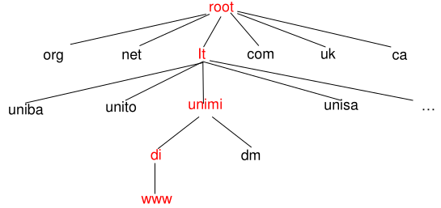
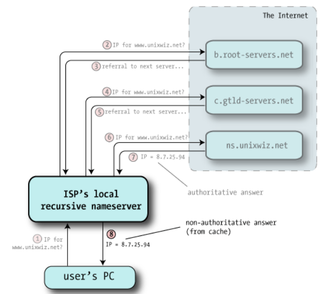
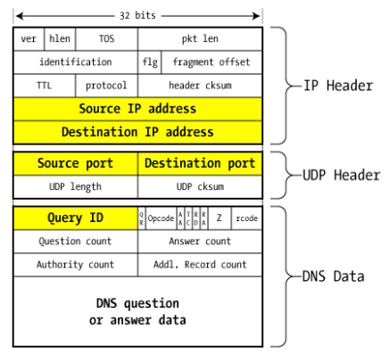
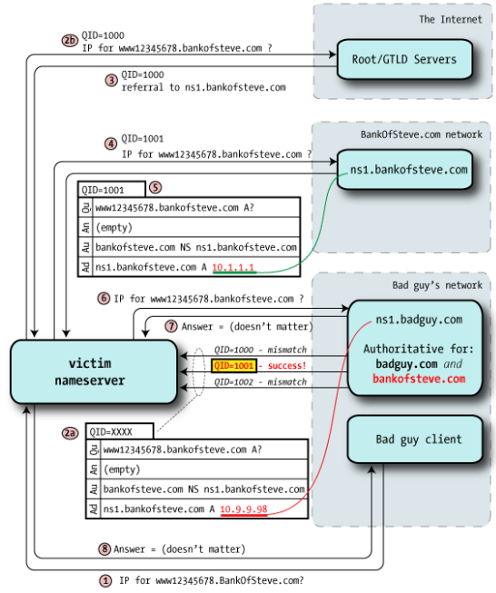
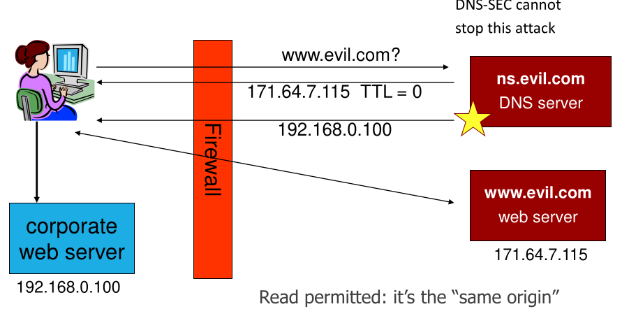

# Vulnerabilità DNS

## 1. Architettura e Spazio dei Nomi DNS
Il Domain Name System (DNS) è un servizio gerarchico progettato per associare nomi di dominio ad indirizzi IP numerici.

Il sistema si basa su un **Hierarchical Name Space** organizzato in questo modo:
* **Root Name Servers:** 13 server principali (identificati dalle lettere da A a M) replicati globalmente in oltre 247 istanze tramite anycast.
* **Top-Level Domain (TLD) Servers:** Responsabili per i domini di primo livello generici (`.com`, `.org`, `.net`) e nazionali (`.it`, `.uk`).
* **Authoritative Name Servers:** Server che contengono i record DNS definitivi e ufficiali per una specifica organizzazione o dominio (es. server di università o grandi aziende).
* **Local Name Resolvers:** I server contattati inizialmente dai client (spesso forniti dall'ISP) che si occupano di interrogare l'infrastruttura per conto dell'utente quando non conoscono un nome.

  

## 2. Zone e Tipi di Record
Una zona DNS è una collezione di coppie hostname/IP gestite congiuntamente da un Authoritative Nameserver.

[IMAGINE - 6a - DNS Protocolli Rete.pdf - slide 4]

I dati all'interno del DNS sono memorizzati in **Resource Records** (RR) che contengono i campi: 
- Name
- Value
- TTL (Time To Live)
- Type

I tipi principali sono

| Tipo Record | Descrizione |
| :--- | :--- |
| **`A`** | Address record (contiene un indirizzo IPv4) |
| **`NS`** | Name Server (punta al server autoritativo per una zona) |
| **`MX`** | Mail eXchanger (indica il server responsabile per la posta elettronica) |
| **`CNAME`** | Canonical Name (crea un alias, un "link" a un altro nome) |
| **`SOA`** | Start of Authority (contiene i parametri globali della zona e i contatti dell'amministratore) |
| **`TXT`** | Generic text (usato spesso per configurazioni di sicurezza e chiavi pubbliche come DKIM o SPF) |

## 3. Il Processo di Risoluzione dei Nomi
La risoluzione si divide in due modalità principali:
* **Recursive Query:** Il server si fa carico dell'intera risoluzione e restituisce al client direttamente la risposta finale (usata tipicamente dai resolver locali degli ISP).
* **Iterative Query:** Il server restituisce una risposta se la conosce, oppure un riferimento (referral) al prossimo server da interrogare (usata nelle comunicazioni tra server DNS).

**Esempio pratico di Lookup (Ricorsivo/Iterativo):**
1.  Il PC dell'utente interroga il Nameserver locale (ricorsivo) per `www.unixwiz.net`.
2.  Non avendo il dato in cache, il Nameserver locale interroga uno dei Root Server.
3.  Il Root Server non conosce il dominio finale ma restituisce un *referral* per i server del TLD `.net`.
4.  Il Nameserver locale interroga il TLD `.net`, che restituisce a sua volta i record *glue* per gli Authoritative Server di `unixwiz.net`.
5.  Il Nameserver locale interroga l'Authoritative Server (`ns.unixwiz.net`) ricevendo il record A (risposta Autorevole).
6.  La risposta viene passata al PC dell'utente e inserita in cache 

  

**Risoluzione Inversa:** Il DNS mappa anche gli IP in nomi di host usando l'ordine inverso dei byte dell'IP sotto lo speciale dominio di primo livello `in-addr.arpa`.
[IMAGINE - 6a - DNS Protocolli Rete.pdf - slide 9]

## 4. Pacchetti e Messaggi DNS
Il DNS utilizza nativamente la porta 53/UDP (e TCP in casi specifici come risposte grandi o zone transfer). I pacchetti hanno una struttura fissa divisa in 5 sezioni:

| Sezione | Descrizione |
| :--- | :--- |
| **Header** | Contiene il *Query ID* (TXID - fondamentale per accoppiare query e risposte) a 16 bit, e i flag operativi |
| **Question** | La query effettiva |
| **Answer** | I Resource Record della risposta |
| **Authority** | I record SOA o NS rilevanti per la delega |
| **Additional** | Informazioni extra, spesso "Glue records" (gli IP dei nameserver citati in Authority) |

  

Flags:
- `QR` (Query / Response) 0: query, 1 response
- `Opcode`: 0 for a standard query
- `AA`: Authoritative Answer
- `RD`: Recursion Desired
- `RA`: Recursion Available)
- `Z`: reserved must be zero
- `rcode`: success or failure

## 5. Vulnerabilità: Cache Poisoning (Avvelenamento della Cache)
L'obiettivo di un attacco di poisoning è inserire falsi record IP nella cache di un nameserver ricorsivo vittima, dirottando così tutti i suoi utenti verso un server controllato dall'attaccante.

Affinché un DNS accetti una risposta, l'attaccante deve forgiare un pacchetto in cui:
* Corrisponda la porta UDP
* La "Question" corrisponda a quella in attesa
* Il Query ID corrisponda alla query in corso
* Si rispetti il "Bailiwick checking" (il server risponde solo per domini di sua competenza)

Il problema con questa versione banale è la dimensione della finestra di attacco: una volta ricevuta risposta l'attaccante deve attendere la scadenza del TTL, diventa quindi molto improbabile indovinare il Query ID.

### Attacco Kaminsky 
Nelle vecchie implementazioni, il Query ID era facilmente predicibile (incrementale), rendendo questo attacco molto più semplice

1.  Invece di aspettare che scada il TTL per `www.banca.com`, l'attaccante invia query per sottodomini inesistenti (es. `1234.banca.com`, `1235.banca.com`) forzando il resolver della vittima a inoltrare costantemente richieste ai Root/TLD.
2.  Nel frattempo, l'attaccante inonda il resolver di risposte contraffatte per `1234.banca.com`, tentando di indovinare il Query ID corretto.
3.  La risposta contraffatta non si limita a risolvere `1234.banca.com`, ma include nella sezione *Authority* e *Additional* (Glue Records) falsi record che delegano l'intera zona `banca.com` ai name server dell'attaccante.
4.  Indovinando un solo pacchetto su migliaia (favorito dalla natura stateless di UDP e dal fatto che forzare query genera continue finestre temporali di vulnerabilità), l'attaccante acquisisce il controllo dell'intera risoluzione di zona, dirottando web e email.

**Difese:** Randomizzazione del Source Port e del Query ID. Usando entrambe le tecniche, lo spazio delle possibilità sale a circa 134 milioni, rendendo il brute-force impercorribile in tempi brevi.

  

## 6. Attacchi Denial of Service (DoS) e Amplification
Il DNS è spesso sfruttato come arma o bersaglio di DoS:
* **"Exploit to Fail":** Sfrutta bug nel parser DNS (es. BIND) inviando pacchetti malformati che mandano in crash il demone (CVE-2002-0400).
* **"Exploit to Own":** Buffer overflow mirato per eseguire codice remoto e ottenere privilegi di root (VU#844360).
* **Reflection & Amplification Attack:** L'attaccante forgia query DNS spoofando l'IP sorgente (mettendo l'IP della vittima). Manda le query a recursor aperti ("Open Resolvers") su Internet. La query è molto piccola (pochi byte), ma richiede una risposta volontariamente gigantesca ("LARGE DNS Response" come record ANY o DNSSEC). I server riflettono queste risposte enormi sulla vittima, amplificando drasticamente l'attacco ed esaurendone la banda.
* **NXDOMAIN Cache Exhaustion:** Si inonda il resolver con richieste di domini inesistenti per riempirgli la cache ed esaurire le risorse.

## 7. Pharming e DNS Rebinding
Il Pharming punta a dirottare gli utenti modificando il file hosts del client o compromettendo i router locali.

### DNS rebinding
Una sofisticata elusione della "Same Origin Policy" (SOP) dei browser:
1.  L'attaccante registra un dominio (`attacker.com`) e imposta un TTL bassissimo (es. 0 o 60 secondi) sul record A puntando al proprio IP pubblico.
2.  La vittima visita il sito. Il browser risolve il nome nell'IP pubblico dell'attaccante e scarica un payload (JavaScript, Applet).
3.  Il payload attende la scadenza del TTL.
4.  A TTL scaduto, l'Authoritative server dell'attaccante fa un *rebind*: risponde alle nuove query DNS puntando il nome `attacker.com` non più all'IP dell'attaccante, ma a un IP *interno* alla LAN della vittima.
5.  Il browser, basandosi sul fatto che il "nome a dominio" non è cambiato (è sempre `attacker.com`), crede di rispettare la Same Origin Policy e permette al payload di interagire liberamente con il dispositivo della rete interna e leggerne i dati.

**Mitigazioni**: è un tipo di attacco scomodo da mitigare, protezioni come DNS Pinning nei browser tendono ad interagire male anche con siti genuini, la soluzione più pratica è un blocco a livello firewall che impedisce di risolvere nomi esterni ad indirizzi interni

  

## 8. DNSSEC: Sicurezza Crittografica
Progettato dall'IETF per fornire Autenticazione dell'Origine e Integrità dei Dati DNS (non garantisce la privacy del canale, i dati restano in chiaro). Previene radicalmente gli attacchi di spoofing.

DNSSEC introduce firme digitali basate su crittografia a chiave pubblica e nuovi record:

| Record | Descrizione |
| :--- | :--- |
| **DNSKEY** | Contiene la chiave pubblica della zona. |
| **RRSIG** | Contiene la firma digitale che autentica un set di record. |
| **DS (Delegation Signer)** | Risiede nel parent (es. nel TLD `.it` per il dominio `miosito.it`) e contiene l'hash della chiave pubblica del figlio. Crea il link nella catena di fiducia. |
| **NSEC / NSEC3** | Record speciali usati per la "Authenticated Denial of Existence", provano crittograficamente che un determinato dominio *non esiste*, evitando risposte vuote non verificabili. NSEC3 usa hash per prevenire la "zone enumeration" (il walking della zona). |

[IMAGINE - 6a - DNS Protocolli Rete.pdf - slide 33]

Le chiavi sono solitamente divise per ragioni di sicurezza:
* **ZSK (Zone Signing Key):** Firma regolarmente i dati. Può essere più debole e viene ruotata spesso.
* **KSK (Key Signing Key):** Firma solo le DNSKEY. Molto più forte, tenuta spesso offline, ed è quella di cui si pubblica l'hash nel record DS genitore per ancorare la fiducia.

Per sopportare pacchetti e firme molto più grandi di 512 byte (il limite storico di UDP su DNS), DNSSEC richiede l'adozione di **EDNS0** e introduce nuovi flag nell'header:
- `AD` (Authenticated Data): inserito dal resolver se il record richiesto è firmato con firma valida e non scadut, con una catena di fiducia autenticata fino ad un punto di fiducia pre-configurato
- `CD` (Checking Disabled): impostato dal querier per accettare dati non autenticati

Nonostante la Root Zone sia firmata dal 2010, l'adozione di DNSSEC procede lentamente a causa della complessità di configurazione, del rischio di interruzione del servizio e della facilitazione di attacchi di Amplification (i record DNSSEC sono enormi). 
