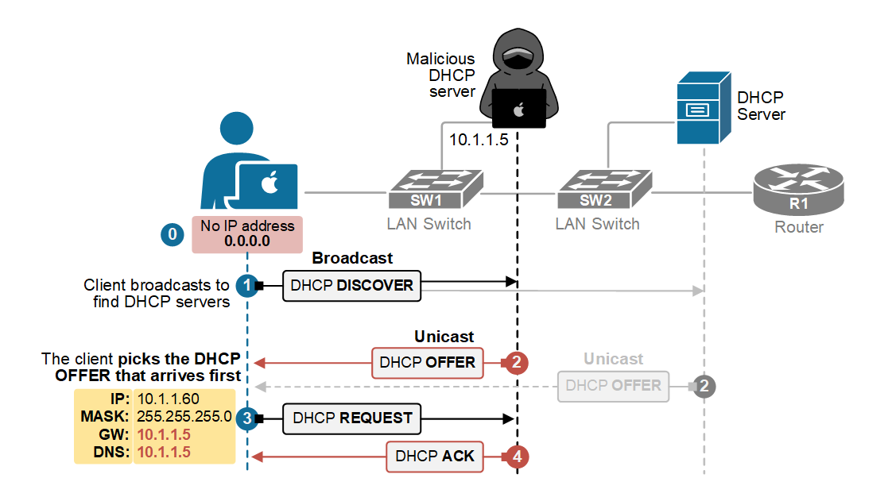
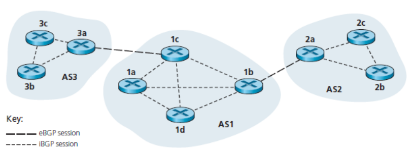
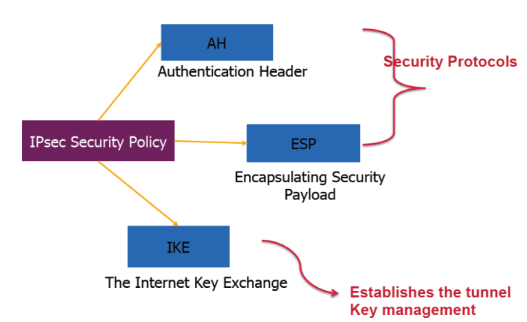
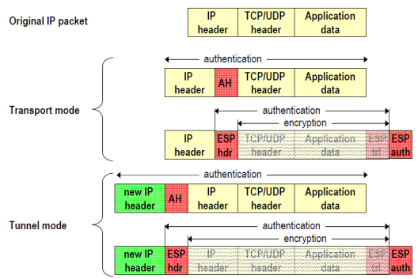

## 1. Attacchi ai Servizi di Rete (DHCP, OSPF, RIP)

### 1.1 DHCP (Dynamic Host Configuration Protocol)
##### Funzionamento**
DHCP si occupa di assegnare dinamicamente indirizzi IP agli host. La comunicazione client-server prevede quattro fasi principali incapsulate in UDP:
1. **DHCP Discover**: L'host invia un messaggio broadcast per cercare un server DHCP sulla rete locale.
2. **DHCP Offer**: Il server DHCP risponde offrendo un indirizzo IP utilizzabile.
3. **DHCP Request**: Il client invia una richiesta formale per accettare l'indirizzo offerto.
4. **DHCP ACK**: Il server conferma l'assegnazione.
Oltre all'IP, il DHCP fornisce parametri essenziali come l'indirizzo del router locale (first-hop gateway), l'indirizzo del server DNS e la network mask.

##### Vulnerabilità

* **DHCP Starvation Attack**: un attaccante invia innumerevoli richieste DHCP con MAC address falsificati, esaurendo il pool di indirizzi.
* **Rogue DHCP Server**: l'attaccante configura un finto server DHCP che fornisce ai client configurazioni malevole (es. gateway fasullo). Questo permette attacchi **Man-in-the-Middle (MitM)**, intercettazione di dati sensibili e (in combinzione con un DNS malevolo)  phishing.

  

##### Mitigazione

* **DHCP Snooping**: configurabile sugli switch di livello 2, filtra i messaggi DHCP provenienti da porte non fidate (untrusted). Utilizza la DHCP Option 82.

### 1.2 Protocolli di Intra-AS Routing (RIP e OSPF)

#### RIP (Routing Information Protocol)
##### Funzionamento
RIP è un protocollo di intra-routing di tipo *Distance Vector* basato sul conteggio degli hop. I router vicini si scambiano periodicamente (ogni 30 secondi) messaggi di aggiornamento (*RIP response message* o *advertisements*) per informare della loro distanza da specifiche sottoreti (fino a 25 per messaggio). La tabella di routing di ogni nodo registra la sottorete di destinazione, il router vicino a cui inoltrare il pacchetto e il costo. I messaggi RIP utilizzano il protocollo UDP sulla porta 520.

##### Vulnerabilità
* **Reflection DDoS**: (usando richieste IP spoofate per amplificare il traffico) o immissione di rotte fasulle per impersonare host o reindirizzare il traffico verso la macchina dell'attaccante.

##### Mitigazione
Restrizione dei pacchetti TCP/UDP 520 sui router di frontiera e Autenticazione (RIPv2 supporta MD5).

#### OSPF (Open Shortest Path First)
##### Funzionamento
OSPF è un protocollo *Link-State*. Invece di scambiarsi solo distanze tra vicini, ogni router distribuisce informazioni sullo stato dei propri collegamenti a tutti i router dell'AS tramite messaggi LSA (*Link-State Advertisements*), inviati in caso di cambiamenti o periodicamente (ogni 30 minuti). 
Raccogliendo tutti gli LSA, ogni router costruisce internamente un'identica mappa topologica della rete e vi applica l'algoritmo di Dijkstra per calcolare l'albero dei percorsi minimi (*shortest-path tree*) avendo se stesso come radice. I messaggi OSPF viaggiano direttamente incapsulati in IP (non usano TCP/UDP) e supportano l'autenticazione.

##### Vulnerabilità

Gli attacchi a OSPF possono sfruttare tecniche generiche come eavesdropping, message replay, message insertion/deletion/modification, Man-in-the-Middle e Denial-of-Service (DoS). 
Questi attacchi mirano a causare gravi danni all'infrastruttura, tra cui congestione di rete, partizionamento, *black-holing* (soppressione del traffico), instabilità (churn e routing loop), o esaurimento delle risorse (overload di messaggi OSPF che saturano memoria e code del router).

* **Max Age Attack**: L'attaccante inietta pacchetti LSA impostando il valore di età massima (3600 secondi, ovvero un'ora). Il router legittimo risponde generando un aggiornamento per contrastare l'anomalia, ma l'aggressore continua a inondare la rete con i pacchetti "max age", causando profonda instabilità e condizioni di DoS.
* **Sequence++ Attack**: L'attaccante inietta un LSA falso con un numero di sequenza incrementato, costringendo i nodi ad accettarlo come un aggiornamento più "fresco". Il router vittima tenta di ripristinare la rotta inviando un LSA con una sequenza ancora maggiore, innescando una continua sovrascrittura che destabilizza il routing globale.
* **Max Sequence Attack**: Viene iniettato un LSA malevolo con il numero di sequenza massimo consentito (`0x7FFFFFFF`). In molti casi, questo pacchetto estremo non viene eliminato dalle difese e persiste nel database per un'ora, garantendo all'attaccante il controllo prolungato del percorso.
* **Bogus LSA Attack**: Sfrutta specifiche vulnerabilità software (come i bug storici nel demone GateD) per forzare OSPF a ricalcolare le rotte alterando in modo malevolo i costi dei collegamenti. Questo permette di reindirizzare tutto il traffico verso un host controllato o provocare crash di sistema.

**Designated Router (DR) Attack**:
All'interno di reti condivise (come le LAN), OSPF elegge un Designated Router (DR) e un Backup DR (BDR) incaricati di inviare gli LSA di rete per conto degli altri nodi; tale elezione avviene tramite lo scambio di pacchetti *Hello*. Un attaccante può alterare il processo in vari modi:
* Falsificare i messaggi *Hello* per eleggere il proprio router (o un "phantom router" inesistente) come DR/BDR.
* Declassare o spogliare del ruolo il DR autentico alterandone i pacchetti in transito.

Prendendo il controllo del ruolo di DR, l'attaccante manipola l'intera visione topologica degli altri nodi, potendo ad esempio isolare l'intera LAN o creare un massiccio *black hole* in grado di intercettare e far cadere la maggior parte del traffico dell'Autonomous System.

## 2. Attacchi al BGP (Border Gateway Protocol)

### 2.1 Introduzione a BGP
Il BGP è il protocollo standard per l'inter-AS routing. 
BGP è un *Path Vector protocol*: scambia informazioni di raggiungibilità delle sottoreti tenendo traccia dell'intero percorso (AS-PATH) per prevenire loop e applicare politiche di instradamento. 
Esistono eBGP (External BGP, tra AS diversi) e iBGP (Internal BGP, all'interno dello stesso AS).

  

### 2.2 Problemi di Sicurezza e Vulnerabilità
BGP è stato progettato senza meccanismi nativi di autenticazione o integrità nei messaggi di Update. Questo permette a un attaccante di:
* Falsificare rotte.
* Creare "Blackhole" per il traffico.
* Deviare il traffico per eavesdropping (intercettazione) o DDoS.

#### Tecniche di Attacco
* **Attacchi Denial of Service**: SYN flooding sui router BGP, invio di TCP RST per causare la caduta della sessione e instabilità (Route-flapping).
* **Prefix Hijacking (Dirottamento del Prefisso)**: un AS annuncia la paternità di un prefisso IP che non possiede. Il router diffonde l'annuncio e il traffico globale viene deviato verso l'AS attaccante.
* **De-aggregation (Traffic Attractor)**: sfruttando la regola per cui i router preferiscono il *longest prefix match* (l'indirizzo più specifico), un AS malizioso può "spezzare" il blocco IP della vittima in blocchi più piccoli e annunciarli. Internet darà precedenza a queste rotte fasulle.
* **AS-Path Shortening**: un AS malevolo può rimuovere degli AS dal vettore per far apparire la propria rotta più breve e attrattiva, ingannando il meccanismo di selezione del miglior percorso.

### 2.4 Difese e Mitigazioni
Risolvere il problema del BGP è difficile per via dell'elevato numero di ISP decentralizzati. Le soluzioni attuali o proposte includono:
* **Route Filtering**: gli ISP controllano mediante egress/ingress filter le rotte comunicate dai peer per verificare la correttezza del possesso degli IP rispetto agli Internet Routing Registries (IRRs).
* **BGP TTL Security Hack (RFC 3682)**: i messaggi eBGP vengono inviati con TTL 255. Il ricevente scarta i pacchetti con TTL inferiore a 254 (poiché i peer diretti sono a distanza di 1 hop), impedendo attacchi da nodi remoti.
* **MD5 Authentication (RFC 2385)**: estensione TCP che calcola un hash MD5 sull'header e payload, proteggendo la sessione da session hijacking e man-in-the-middle. Non usa IPsec direttamente ma agisce al livello TCP.
* **RPKI (Resource Public Key Infrastructure) e S-BGP**: meccanismi crittografici basati su Public Key Infrastructure. RPKI fornisce i ROA (Route Origin Authorizations) firmati dai RIR (es. RIPE, ARIN) per attestare l'appartenenza dei prefissi agli ASN. S-BGP (Secure BGP) aggiunge la firma crittografica degli attributi e dell'AS-PATH, benché la sua adozione globale sia frenata dai costi computazionali e dalla necessità di supporto generalizzato da tutti gli ISP.

## 3. IPSEC e VPN

### 3.1 Introduzione allo Stack dei Protocolli e Problemi di Sicurezza
Il protocollo IP di per sé è *unreliable* e *connectionless*, e non offre:
* Autenticazione e integrità dei dati.
* Confidenzialità.
* Non-ripudio.

Problemi tipici includono il *Source Spoofing* e i pacchetti *Replay*. La protezione può avvenire a diversi livelli:
* **Livello 1 e 2**: Protezione fisica, WEP, 802.1x (Access control basato su porta LAN).
* **Livello 3**: **IPsec** (Autenticazione mutua, Access control, Confidenzialità e Integrità dei dati).
* **Livello 4+**: SSL/TLS (Secure Sockets Layer / Transport Layer Security) over TCP.

### 3.2 Architettura IPSEC
IPsec è una suite di protocolli standardizzata progettata per proteggere le comunicazioni su reti IP mediante l'autenticazione e/o la crittografia di ogni pacchetto IP in una sessione di dati. Include:
* **IKE (Internet Key Exchange)**: negozia i parametri di sicurezza e stabilisce le chiavi (usa UDP porta 500 per ISAKMP).
* **ESP (Encapsulating Security Payload)**: cifra, autentica e rende sicuri i dati.
* **AH (Authentication Header)**: fornisce autenticazione e integrità, ma non confidenzialità.

  

#### Protocolli AH ed ESP
* **AH**: garantisce **autenticazione dell'origine** e **integrità dei dati**. Usa un Sequence Number a 32-bit contro gli attacchi replay ed algoritmi di hashing per la firma dei dati. Firmando anche l'header IP, AH è spesso incompatibile con NAT.
* **ESP**: aggiunge la **confidenzialità** (crittografia simmetrica) a quanto offerto da AH. In modalità Tunnel con ESP, l'intero pacchetto originale è cifrato, rendendo impossibile per un intermediario determinare gli indirizzi IP sorgente/destinazione originari.

#### Modalità di Funzionamento
I protocolli base di IPsec (AH ed ESP) possono operare in due diverse modalità, influenzando come viene gestito l'header IP:

*   **Transport Mode**: Si utilizza tipicamente per comunicazioni end-to-end tra host (es. da client a server). In questo caso gli "endpoint crittografici" coincidono con gli "endpoint di comunicazione".
    *   *AH in Transport Mode*: AH si inserisce tra l'header IP originale e il payload (es. TCP/UDP). Fornisce autenticazione dell'intero pacchetto (tranne i campi mutabili dell'header IP come il TTL). 
    *   *ESP in Transport Mode*: L'header ESP viene inserito dopo l'header IP originale e prima del payload. Il payload viene cifrato (e il trailer aggiunto), seguito dai dati di autenticazione ESP. L'header IP originale è lasciato in chiaro, permettendo l'instradamento nella rete.

*   **Tunnel Mode**: Si utilizza quando almeno un endpoint crittografico non è l'endpoint finale della comunicazione (tipico delle VPN site-to-site tra due gateway o router). Il pacchetto IP originale viene interamente incapsulato in un nuovo pacchetto IP.
    *   *AH in Tunnel Mode*: L'intero datagramma IP originale (header e payload) è protetto e inserito in un nuovo pacchetto IP. AH autentica sia il vecchio pacchetto che le parti immutabili del nuovo header IP esterno.
    *   *ESP in Tunnel Mode*: L'intero pacchetto IP originale è considerato payload, viene cifrato e racchiuso tra l'header e il trailer ESP. Un nuovo header IP in chiaro viene preposto per instradare il pacchetto nel tunnel. La vera destinazione (contenuta nell'IP header originale) non è accessibile a chi ispeziona il traffico intermedio.

  

#### Gestione delle Policy e Security Associations (SA, SADB, SPD)
L'architettura IPsec utilizza tre componenti fondamentali per decidere come proteggere il traffico e mantenere lo stato delle connessioni sicure:

*   **SA (Security Association)**: È un concetto fondamentale in IPsec e definisce una collezione di attributi associati a una specifica connessione sicura. La SA è **unidirezionale** e **asimmetrica** (se ne richiedono almeno due per una comunicazione bidirezionale: una per il traffico in ingresso e una per quello in uscita). Una SA viene identificata univocamente da tre parametri:
    * *SPI (Security Parameter Index)*: un indice a 32 bit che svolge un ruolo simile ai numeri di porta nel TCP/UDP, indicando a quale SA appartiene il pacchetto entrante per processarlo correttamente.
    *  *Indirizzo IP di destinazione*.
    *  *Identificatore del protocollo di sicurezza* (AH o ESP).

*   **SPD (Security Policy Database)**: È il database che memorizza le politiche di sicurezza locali. Le politiche si basano sui selettori di traffico (IP locale, IP remoto, porte, protocolli come TCP/UDP). Per ogni flusso in rete, l'SPD forza una delle seguenti azioni:
    *   *DISCARD*: il pacchetto viene scartato silenziosamente (es. regole di default deny per traffico intruso).
    *   *BYPASS*: il pacchetto viene fatto passare in chiaro senza applicare IPsec (es. per consentire ICMP, o traffico HTTPS laddove l'amministratore voglia evitare di incapsulare una comunicazione già cifrata con TLS).
    *   *PROTECT*: si richiede l'intervento di IPsec stabilendo o usando una SA esistente (es. forzare l'uso di "ESP in Transport Mode con 3DES" per le comunicazioni da un host a un server specifico).

*   **SADB (Security Association Database)**: È il database operativo che memorizza lo stato corrente di tutte le SA attive create tra i peer. Per ogni SA, il SADB contiene i parametri crittografici correnti negoziati (algoritmi, chiavi per la cifratura/autenticazione generate tramite IKE, durata della sessione e contatori dei Sequence Number).

#### Protezione Anti-Replay
Sia i pacchetti protetti con AH che con ESP utilizzano un Sequence Number. 
Il mittente lo inizializza a zero quando stabilisce la SA e lo incrementa per ogni pacchetto trasmesso. Il ricevente esegue il controllo mantenendo una "sliding window" (finestra scorrevole, la cui dimensione minima pratica è di 32, o tipicamente 64 pacchetti). 
* Se un pacchetto arriva con un Sequence Number situato alla *sinistra* della finestra (ovvero un valore vecchio), il ricevente lo rigetta considerandolo un potenziale Replay Attack.
* Se è all'interno della finestra (non ancora visto e con ICV valido) o alla *destra* della finestra, il pacchetto è accettato e la finestra scorre di conseguenza.

### 3.3 IKE (Internet Key Exchange)
L'IKE fornisce un modo automatico per negoziare parametri e chiavi per IPsec. Si divide in due fasi:
* **Fase 1**: crea un canale sicuro (ISAKMP SA) tra i peer. Opera in:
    * **Main Mode**
        * Tre scambi di informazioni tra i peers IPsec
        * Iniziatore manda una o più proposte all’altro peer (responder)
        * Il Responder seleziona una proposta 
    * **Aggressive Mode** (più rapido ma meno sicuro, suscettibile a sniffing).
        * Primo pacchetto mandato dall’ iniziatore contiene tutte le info per stabilire una SA
        * Il secondo pacchetto dal responder con tutti i parametri di sicurezza selezionati
        * Il terzo pacchetto conclude l’autenticazione della sessione ISAKMP
* **Fase 2**: negozia le singole SA IPsec (unidirezionali) usate per il trasferimento dei dati, operando sul canale sicuro instaurato nella Fase 1.

### 3.4 Virtual Private Network (VPN)
Le VPN permettono di creare una rete privata sicura su una rete pubblica (Internet) eliminando il bisogno di costose linee dedicate.
* **Trusted VPN**: il provider garantisce l'integrità del percorso (es. MPLS), ma non ci sono garanzie di cifratura contro le intrusioni.
* **Secure VPN**: usa crittografia (come IPsec o SSL/TLS) per proteggere i dati nel transito, comportandosi come un "Tunnel".
* **Hybrid VPN**: unione delle due precedenti.

**Tipologie Topologiche**:
* **Intranet VPN**: collega sedi fisse aziendali.
* **Remote Access (RAS) VPN**: collega client remoti a un gateway aziendale.
* **Extranet VPN**: collega reti di partner limitando gli accessi mediante firewall.

**Protocolli VPN**:

Oltre a IPsec, esistono **L2TP** e **PPTP** (oggi ritenuti insicuri a causa di vulnerabilità nell'MS-CHAP v2 e interventi della NSA, come rivelato dai leak di Snowden), **SSTP** (proprietario Microsoft) e **OpenVPN** (basato su OpenSSL, altamente flessibile, utilizza UDP/TCP per by-passare la censura, sebbene richieda software di terze parti).

