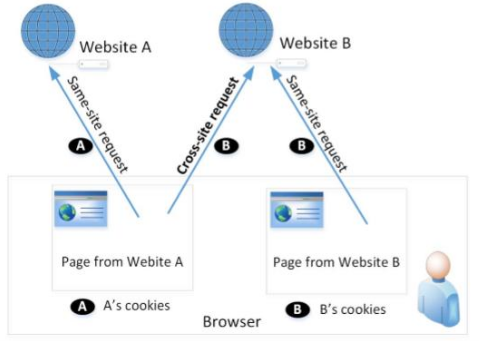

## Architettura Web e Protocollo HTTP
L'architettura di base del web si fonda sull'interazione continua tra il Browser (lato client), il Web Application Server e un Database.

Il server web riceve le richieste e restituisce codice scritto in linguaggi specifici, interpretati dal browser:
* Il linguaggio HTML fornisce la struttura e i contenuti ipertestuali della pagina.
* I fogli di stile a cascata (CSS) hanno lo scopo di separare il contenuto dallo stile di presentazione visiva.
* JavaScript (noto anche come ECMAScript) è il linguaggio di scripting che permette l'esecuzione di codice dinamico all'interno della pagina web.
* I server HTTP, come Apache, possono interagire con le applicazioni web tramite interfacce specifiche come CGI, FastCGI o tramite moduli per l'esecuzione diretta di script basati su PHP, Python o ASP.

Il protocollo HTTP regola la comunicazione attraverso richieste inviate dal client e risposte restituite dal server.
* La richiesta HTTP di tipo GET invia i dati al server allegandoli direttamente all'interno dell'URL.
* La richiesta HTTP di tipo POST inserisce i dati all'interno del campo dati (body) della richiesta stessa.

## Gestione dello Stato e Cookie

Il server web è intrinsecamente "senza stato" (stateless), il che significa che non mantiene nativamente una connessione a lungo termine con il client.

* I cookie HTTP vengono utilizzati per sopperire a questa mancanza salvando le informazioni direttamente sul lato client.
* Il browser memorizza questi cookie e li allega automaticamente a ogni richiesta successiva effettuata verso il server di destinazione.
* I cookie di sessione sono fondamentali per la sicurezza, poiché memorizzano un ID di sessione univoco (solitamente un numero casuale) creato dopo l'accesso dell'utente.
* Possedere l'ID di sessione equivale ad avere l'accesso garantito al sistema autenticato.

Esistono tuttavia problematiche legate al tracciamento e alla privacy.
* I cookie di terze parti sono spesso utilizzati dalle reti pubblicitarie (Advertisement Network) per tracciare il comportamento degli utenti attraverso domini e siti differenti.

## JavaScript, Sandbox e Comunicazione Asincrona

Il codice JavaScript viene eseguito all'interno del browser in un ambiente sandboxed.
* Il codice JavaScript può accedere ai dati in-page (DOM), ai dati di navigazione del browser (come cookie e cronologia) e interfacciarsi con la rete.
* Non può tuttavia accedere direttamente al file system locale di sistema senza che l'utente conceda un'esplicita autorizzazione (ad esempio tramite la selezione manuale di un file).

Per la comunicazione di rete lato client, vengono adottati meccanismi asincroni come Ajax e WebSocket:
* Ajax (Asynchronous JavaScript and XML) utilizza richieste HTTP standard in modalità half-duplex, dove il browser invia una richiesta e attende che il server risponda.
* Sulle comunicazioni Ajax interviene la politica della Stessa Origine (Same-Origin Policy), la quale blocca la lettura della risposta da parte del browser se la richiesta è diretta verso un dominio diverso, prevenendo compromissioni della privacy.
* Il meccanismo CORS (Condivisione delle Risorse tra Origini) consente di allentare questa restrizione rigorosa tramite una whitelist di origini fidate fornita direttamente dal server.
* WebSocket differisce offrendo una comunicazione di tipo full-duplex, permettendo a browser e server di inviare dati in modo bidirezionale e continuo.
* A differenza di Ajax, il browser non limita i dati provenienti da WebSocket tramite la Same-Origin Policy, demandando il controllo critico degli accessi e la verifica dell'origine direttamente al lato server.

## Cross-Site Request Forgery (CSRF)

La falsificazione delle richieste tra siti (CSRF) è un attacco informatico che sfrutta l'automazione dei browser.

* Il problema principale alla base del CSRF risiede nell'incapacità del server di distinguere autonomamente tra una richiesta legittima proveniente dal proprio sito (same-site) e una richiesta falsificata proveniente dall'esterno (cross-site).
* Questo accade perché il browser dell'utente, in buona fede, allega in modo automatico i cookie di sessione validi in entrambe le casistiche.

  

Gli attacchi possono bersagliare diverse tipologie di richieste:
* Negli attacchi CSRF su servizi HTTP GET, l'aggressore inserisce codice (come tag `` o `<iframe>`) in una propria pagina malevola; appena la vittima la visita, il browser esegue una richiesta GET all'URL specificato, attivando l'azione sul sito bersaglio.
* Negli attacchi CSRF su servizi HTTP POST, l'aggressore può utilizzare script JavaScript nascosti all'interno della pagina per creare dinamicamente un modulo HTML (form) e forzarne l'invio automatico senza che l'utente debba cliccare alcun pulsante.

Esistono diverse contromisure tecniche per bloccare le vulnerabilità CSRF:
* L'intestazione HTTP "Referer" identifica l'indirizzo della pagina di origine della richiesta, ma viene spesso rimossa dai client per preservare la cronologia e la privacy, rendendola una fonte inaffidabile per i server.
* L'attributo "SameSite" dei cookie (che può assumere i valori *Strict* o *Lax*) indica al browser di non inviare il cookie nel caso in cui venga rilevata una richiesta cross-site.
* L'implementazione di un token segreto casuale, generato dal server e inserito all'interno di ogni pagina web (spesso come campo nascosto nei form), garantisce sicurezza; l'attaccante non può leggerlo o indovinarlo a causa delle limitazioni imposte dalla Same-Origin Policy.

## Cross-Site Scripting (XSS)

Il Cross-Site Scripting è una vulnerabilità che si verifica quando un'applicazione web esegue nel browser della vittima uno script malevolo iniettato da un aggressore esterno.

* Poiché il codice JavaScript sembra provenire dal sito web originale, il browser lo considera attendibile e gli concede i medesimi privilegi del sito.
* Il codice malevolo può alterare il contenuto del DOM, inviare richieste di spoofing per conto dell'utente, e rubare dati sensibili privati come i cookie di sessione.

Esistono due macro-categorie principali per l'esecuzione di attacchi XSS:
* **Attacco XSS non persistente (riflesso)**: Se il server web accetta input non filtrati e li rimanda (riflette) indietro all'utente, un aggressore può nascondere il codice JavaScript in un link generato ad hoc; quando la vittima ci clicca sopra, la pagina restituita includerà il codice eseguibile.
* **Attacco XSS persistente (memorizzato)**: L'aggressore invia il proprio payload malevolo a un sito web in modo che venga archiviato permanentemente (ad esempio all'interno di un commento o di un profilo utente); chiunque visualizzi successivamente quel contenuto eseguirà il codice sul proprio dispositivo.

Gli attacchi XSS persistenti possono essere utilizzati per creare un worm XSS:
* Sfruttando le API del DOM, un worm JavaScript può accedere al proprio nodo interno per ottenere una copia del proprio codice sorgente.
* In alternativa, tramite l'approccio di collegamento, il codice JavaScript può essere incluso nella pagina infetta includendo l'attributo `src` rivolto verso il server dell'attaccante.
* Ogni volta che il profilo infetto viene visitato da una nuova vittima, il codice malevolo modifica dinamicamente il profilo del visitatore iniettando una copia del worm e garantendone l'espansione esponenziale.

Per mitigare efficacemente il rischio associato agli attacchi XSS, i sistemi adottano approcci di difesa standardizzati:
* Filtri per codice JavaScript potenzialmente pericoloso (es. tag `<script>`) sugli input dell'utente utilizzando librerie specifiche.
* La codifica di markup HTML come entità sicure prima di renderizzarli sulla pagina, forzando i browser a visualizzarli come semplice testo stringa senza eseguirli.
* La Content Security Policy (CSP) è un'intestazione di sicurezza che sconfigge l'XSS vietando categoricamente l'esecuzione di script in linea (inline) e obbligando la definizione di una rigida whitelist di origini permesse o l'adozione di "nonce" crittografici autorizzati.
