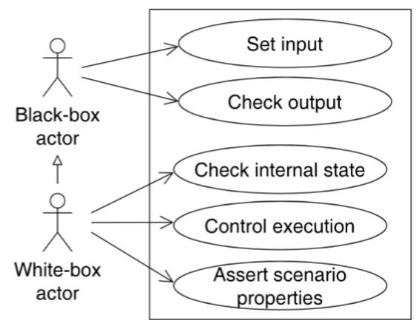
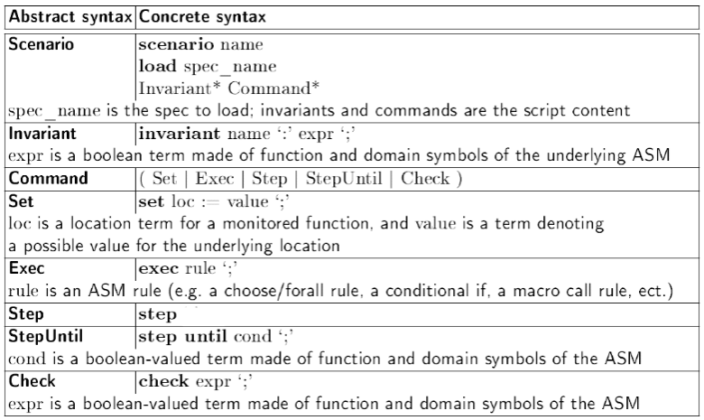

# Analisi di modelli
L'analisi di modelli può segue due approcci:
- **Validazione**: il modello soddisfi i requisiti
- **Verifica**: il modello garantisce le proprietà

Andrebbe eseguita prima la verifica e poi la validazione.

## Invarianti
In un ASM gli invarianti esprimono vincoli su funzioni e/o regole che devono essere garantiti in ogni stato.
Possono anche essere usati come strumento diagnostico per individuare errori di modellazione.

> **AsmetaL**
>
> Gli invarianti vanno dichiarati subito prima della `main` rule usando la keyword `invariant`, le funzioni e regole si cui è espresso il vincolo vanno elencate dopo la keyword `over`.
> ```
> invariant invName over id_function,...,id_rule:term
> ```

## Validazione tramite scenari
> **Def.**
> 
> **Tecniche**: Generazione di scenari, sviluppo di prototipi, animazione, simulazione, testing
> 
> **Scenario**: descrizione di un possibile comportamento del sistema $\to$ interazione osservabile tra il sistema ed il suo ambiente in specifiche situazioni.

Gli scenari vengono costruiti attraverso notazione tesutale (Avalla) in termini ASM. 

Un Actor ASM può agire con:
- black box view: analogo ad UML, monitora solo l'output per un certo input
- white box view: può monitorare lo stato interno, la sequenza di esecuzioni e proprietà dello scenario

<p align="center">
  
</p>

Gli scenari ASM sono sequenze di interazione costituite da azioni:
- Da parte di user/observer:
    1. set the environment (i.e. the values of monitored/shared functions)
    2. check for the machine outputs (i.e. the values of out functions),
    3. check the machine state and invariants
    4. ask for the execution of given transition rules
- Da parte della macchina:
    - Makes one step as reaction of the actor actions

#### Primitive AValLa
| Comando | Descrizione |
| :--- | :--- |
| **Set** | Un comando per impostare la locazione di una funzione (monitorata) a un valore specifico: simula l'**ambiente**. |
| **Check** | Per ispezionare i valori esterni e (solo per l'osservatore) per ispezionare i valori interni nello stato corrente. |
| **Step** | Per segnalare che l'ambiente ha terminato l'aggiornamento delle locazioni monitorate, di conseguenza la macchina può eseguire un passo. |
| **StepUntil** | Per segnalare che la macchina può eseguire un passo iterativamente finché una condizione specificata non diventa vera. |
| **Invariant** | Per dichiarare proprietà critiche della specifica che dovrebbero essere sempre valide per un dato scenario. |
| **Exec** | Per eseguire una regola di transizione quando richiesto dall'osservatore. |

#### Sintassi AValLa
<p align="center">
  
</p>


