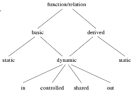

# Metodi Formali e Abstract State Machines (ASM)

## 1. Introduzione ai Metodi Formali
Distinguiamo due tipi principali di sistemi software dipendenti:
* **Life-critical system**: il loro malfunzionamento mette in pericolo vite umane.
* **Mission-critical systems**: i malfunzionamenti causano perdite finanziarie o di asset.

Al fine di garantire la correttezza dei sistemi, vengono definiti i **metodi formali**, ovvero tecniche matematicamente ben fondate progettate per assistere lo sviluppo di sistemi complessi.

Un metodo formale è composto da 

* Linguaggi: Notazioni matematiche con semantica formale atti a definire modelli e le loro proprietà
* Tools: Strumenti software a supporto dello sviluppo di FM
* Metodologie:
    * Linee guida per l’utilizzo di un FM
    * Processo per supportare l’uso durante le varie fasi
    * Proof strategies: tecniche di dimostrazione formale

Questi metodi vengono applicati in tre fasi principali del ciclo di vita del software:
* **Design time**: applicazione in fase di costruzione e modellazione.
* **Development time**: ricerca di difetti durante la codifica delle specifiche.
* **Run time**: verifica del software a scatola chiusa.

### Tipologie di Specifiche e Modelli
La specifica di modelli consiste nella descrizione di un sistema in termini di oggetti matematici. In questo processo si differenziano due tipologie principali di formalismi:
* **Operazionali**: descrivono il comportamento del sistema definendo cosa e come deve operare attraverso una macchina astratta. Essendo modelli costruttivi, permettono di generare automaticamente l'implementazione. Tra questi troviamo le Macchine a Stati Finiti (FSM), come le Macchine di Mealy e le FSM di Harel.
* **Dichiarativi**: descrivono il comportamento in termini di proprietà e vincoli, indicando cosa deve fare il sistema ma non come. Sono non costruttivi e più orientati alla verifica.

## Macchine di Mealy
Versione di FSM con la possibilità di rappresentare sia input che output. Un ulteriore espansione sono le FSM estese che permettono di rappresentare uno spazio di memoria.
Per rappresentare l’interazione tra più FSM si utilizzano le FSM di comunicazione, i cui nodi rappresentano FSM che comunicano attraverso channel.
In aggiunta vi è la rappresentazione tramite FSM di Harel (FSM).

## Abstract State Machines (ASM)
Le ASM ampliano la definizione classica di FSM sostituendo i semplici stati di controllo con uno stato corrente (struttura del primo ordine multi-sorted) in grado di modellare dati complessi.

> **Def.**
> Un ASM è una tripla $(\Sigma, A, R)$ con:
> * $\Sigma$: vocabolario (collezione finita di nomi di funzione)
> * $A$: stato iniziale 
> * $R$: insieme di regole di transizione contenente
>   * *main rule*: un nome di regola con arietà 0 che funge da entry point 
>   * Una definizione di regola per ogni nome di regola

L'esecuzione (o run) di una ASM è una sequenza di stati che parte dallo stato iniziale; ogni nuovo stato si ottiene eseguendo simultaneamente tutte le regole di transizione applicabili nello stato precedente.

## Funzioni

> **Def.**
> Dato un vocabolario $\Sigma$, uno stato $A$ su $\Sigma$ è un insieme $X \neq \empty$ detto **superuniverso** di $A$, contenente le interpretazioni dei nomi di funzioni in $\Sigma$:
> * Se $f$ è un nome di funzione n-aria di $\Sigma$ allora la sua interpretazione $f^A : X^n \to X$.
> * Se $f$ è un nome di costante di $\Sigma$ allora la sua interpretazione $c^A: x \in X$. 

### Classificazione delle Funzioni

* **Funzioni statiche di arietà 0**: costanti (ie – `undef`, `True`, `False`, …) 
* **Funzioni statiche (di arietà >0)**: definite tramite una legge indipendente dallo stato (ie - `+`, `-`, `max(n,m)`, …)
* **Funzioni dinamiche**: cambiano interpretazione in base allo stato. Funzioni dinamiche di arietà 0 sono l’analogo delle variabili

  

* **Statiche**: sono definite da una legge indipendente dallo stato; le funzioni statiche di arietà 0 sono le costanti (es. `undef, True, False`).
* **Dinamiche**: cambiano la propria interpretazione in base allo stato della macchina. A loro volta si classificano in:
    * **In (Monitored)**: lette dalla macchina ma scritte dall'ambiente.
    * **Out**: scritte dalla macchina ma lette dall'ambiente.
    * **Controlled**: lette e scritte dalla macchina.
    * **Shared**: lette e scritte sia dalla macchina che dall'ambiente.
    * **Derived**: i valori sono calcolati a partire da funzioni statiche e monitorate tramite una legge o schema fissato a priori.

### 3.2 Locazioni e Aggiornamenti
Una locazione in una ASM è una coppia formata dal nome della funzione e dai suoi argomenti, ad esempio (f, v1,...,vn). Aggiornare stati astratti significa cambiare l'interpretazione (e quindi il valore) delle funzioni dinamiche in specifiche locazioni.
Un insieme di aggiornamenti (update set) è consistente se non tenta di assegnare valori diversi alla medesima locazione. Se è consistente, l'update set può essere applicato (fired) per generare il nuovo stato.

## 4. Regole di transizione
Aggiornare stati astratti significa cambiare l’interpretazione di un qualsiasi numero di funzione dinamiche della segnatura della macchina.
Il cambiamento dell’interpretazione delle funzioni è descritto da regole di transizione.

* **Update rule**
  Costrutto di base delle regole di transizione, determina l’aggiornamento di una locazione ASM.
  f(t1,...,tn) := s
  Dove:
  f è un nome di funzione dinamica n-arina in Sigma
  t1,...,tn ed s sono termini di Sigma
  Per funzioni 0-arie (variabili) ha forma x:=s

* **Conditional rule**
  if psi then R else S
  Se psi espressione booleana è vera esegui R, altrimenti esegui S.

* **Skip rule**
  skip
  Non fare nulla

* **Let rule**
  let x=t in R(x)
  Assegna il valore di t ad x ed esegue R. Utilizzata come abbreviazione.

* **Block Rule**
  par
  R
  S
  endpar
  Consente di eseguire R ed S in parallelo (un'unica transizione invece di multiple). Modella syncronous bounded parallesim (applicazione simultanea di un numero finito di funzioni).
  NB: In casi in cui degli aggiornamenti dipendano da altri valori alterati nello stesso aggiornamento par, questi fanno riferimento al valore precedente all’esecuzione delle istruzioni in par.

* **(Macro) Call Rule**
  R [t1,...,tn]
  chiama R (regola con parametri) con argomenti t1,..., tn.

* **Forall Rule**
  forall x with phi do R[x]
  esegue R in parallelo per ogni x che soddisfa phi. Implementa parallellismo sincrono (potentially unbounded).

* **Choose Rule**
  choose x with phi do R[x]
  Sceglie randomicamente x che soddisfa phi.
  NB. Più scelte sullo stesso insieme in parallelo possono abbastanza facilmente portare ad aggiornamenti inconsistenti (ie. Aggiorna stato di più elementi da insieme in par).

* **Extend rule**
  import x do R[x]
  Sceglie un elemento fresco dalla Reserve, lo rimuove, lo aggiunge all'universo in uso ed esegue R su di esso.
